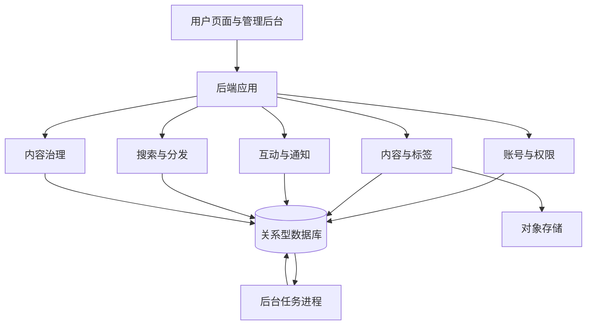

# 技术 UGC 博客社区 MVP 产品设计文档

| 项目 | 内容 |
| --- | --- |
| 项目名称 | Broker Blog（暂定） |
| 文档版本 | v0.1 |
| 更新日期 | 2026-10-14 |
| 文档状态 | 评审稿，可用于拆解设计与开发任务 |
| 产品定位 | 面向技术用户的文章创作、阅读和交流社区 |
| 参考产品 | CSDN、掘金；仅参考产品形态，不复刻完整功能 |

## 1. 背景与目标

### 1.1 产品背景

为技术作者提供可靠的创作和发布工具，为读者提供容易发现、检索和交流的技术内容空间。MVP 先验证内容供给与消费闭环，再扩展推荐、创作者成长和商业化能力。

当前项目尚无已确认的目标细分人群、流量规模、预算和上线时间。本稿按“小团队、从零启动、中文技术文章为主、桌面创作与移动阅读并重”设计。以下为建议方案，不代表已完成用户调研或业务验证。

### 1.2 MVP 目标

1. 作者能够完成注册、保存草稿、发布文章，并获得阅读和互动反馈。
2. 读者能够通过首页、标签和搜索找到文章，完成收藏、评论或关注。
3. 管理员能够处理违规内容和账号，保持社区基本秩序。
4. 团队能够通过基础数据判断用户是否持续阅读和创作。

核心闭环：**创作 → 发布 → 内容分发 → 阅读 → 互动反馈 → 再次创作**。

### 1.3 非目标

MVP 不包含付费文章、课程、资源下载、广告交易、企业账号、私信、积分商城、复杂等级体系、AI 写作、协同编辑、个性化机器学习推荐或微服务拆分。

## 2. 用户与场景

| 用户 | 核心需求 | 典型场景 | 产品响应 |
| --- | --- | --- | --- |
| 技术作者 | 稳定发布经验并获得反馈 | 整理排错过程、分享项目实践 | Markdown、草稿保存、发布、互动通知 |
| 技术读者 | 找到可用内容并保存 | 搜索具体问题，收藏有价值的文章 | 搜索、标签、收藏列表 |
| 社区参与者 | 与作者交流并持续跟进 | 评论提问、关注作者 | 评论回复、关注、站内通知 |
| 管理员 | 维护内容质量与基本秩序 | 处理举报、下架文章、封禁账号 | 管理后台、举报队列、操作日志 |

作者和读者共用普通用户身份，不设作者申请门槛。发布内容前必须登录且账号状态正常。

### 2.1 权限矩阵

| 操作 | 游客 | 普通用户 | 管理员 |
| --- | --- | --- | --- |
| 阅读公开文章、搜索、浏览主页 | 支持 | 支持 | 支持 |
| 发布、编辑文章 | 不支持 | 仅自己的文章 | 不直接修改他人正文；可以下架 |
| 点赞、收藏、关注、评论、举报 | 登录后继续 | 支持 | 支持 |
| 查看草稿和收藏 | 不支持 | 仅自己的内容 | 无常规浏览私有草稿入口 |
| 删除评论 | 不支持 | 仅自己的评论 | 可隐藏违规评论 |
| 精选文章、处理举报、封禁账号 | 不支持 | 不支持 | 支持并留痕 |

封禁用户不得新增或修改内容、互动及举报；可查看封禁提示和退出登录。历史文章是否下架由管理员另行处理，不随封禁自动批量删除。

## 3. 版本范围与优先级

P0 为公开试用前必须完成的功能；P1 为试用后的首轮优化；P2 为有数据或需求依据后的扩展。P0 功能也可以分批开发，但公开试用前必须形成完整闭环。

| 领域 | P0：MVP | P1：首轮优化 | P2：后续扩展 |
| --- | --- | --- | --- |
| 账号 | 单一注册登录方式、资料、退出、账号状态 | 第三方登录、账号注销自助流程 | 机构账号、认证、复杂权限 |
| 创作 | Markdown、预览、代码高亮、图片上传、草稿、发布、编辑、删除 | 版本历史、专栏、定时发布 | 协作编辑、内容付费 |
| 分发 | 精选、最新、标签列表、作者主页 | 热门、关注流、同标签推荐 | 个性化推荐 |
| 搜索 | 关键词检索、相关性与最新排序 | 联想词、纠错、筛选增强 | 语义搜索、个性化排序 |
| 互动 | 点赞、收藏、两层评论、关注 | 收藏夹、评论排序、通知聚合 | 私信、群聊、激励体系 |
| 通知 | 评论、回复、新关注通知、未读状态 | 通知偏好、批量聚合 | 邮件或其他渠道推送 |
| 治理 | 举报、下架、隐藏评论、封禁、审计 | 审核辅助、申诉工作流 | 信用体系、复杂反作弊 |
| 数据 | 基础计数、核心事件、管理统计 | 作者分析、搜索质量分析 | 实验平台、推荐数据体系 |

P0 保留关注关系和关注列表，关注内容信息流放入 P1。点赞不产生通知，避免初期通知噪声。

## 4. 信息架构与页面设计

### 4.1 全站结构

桌面端顶部导航包含首页、搜索、写文章、通知和用户菜单。移动端保留相同能力，折叠次要操作；文章阅读、搜索和互动优先适配手机，编辑器至少支持基本使用。

| 页面 | 建议路径 | 核心内容与操作 |
| --- | --- | --- |
| 首页 | `/` | 精选/最新切换、文章列表、标签入口、写文章入口 |
| 标签页 | `/tags/:slug` | 标签简介、该标签下最新文章 |
| 搜索页 | `/search?q=` | 搜索词、结果数、排序、分页、空结果提示 |
| 文章详情 | `/articles/:id` | 标题、作者、时间、标签、正文、互动区、评论区 |
| 作者主页 | `/users/:id` | 头像、昵称、简介、公开文章、关注按钮、关注/粉丝列表 |
| 登录与注册 | `/login`、`/register` | 身份验证、条款与隐私入口、返回原页面 |
| 编辑器 | `/editor/:id` | 标题、正文、预览、保存状态、发布入口 |
| 内容管理 | `/me/articles` | 草稿、已发布、已下架三个列表及对应操作 |
| 我的收藏 | `/me/bookmarks` | 私有收藏列表、取消收藏、失效内容提示 |
| 个人设置 | `/settings/profile` | 头像、昵称、简介 |
| 通知中心 | `/notifications` | 消息列表、未读标识、全部已读 |
| 管理后台 | `/admin` | 内容、用户、举报、标签、精选及操作记录 |

### 4.2 关键页面要求

**首页文章卡片：** 展示标题、摘要、作者、发布时间、标签和基础互动计数；封面非必填。精选列表为空时展示最新文章，不出现空白首页。

**文章详情：** 正文优先，代码块支持横向滚动；桌面可展示目录，移动端目录可折叠。页面提供稳定链接、浏览器标题、描述信息和可抓取正文。编辑后的文章保留原链接，同时显示更新时间。

**编辑器：** 持续展示“未保存 / 保存中 / 已保存 / 保存失败”状态。发布配置集中填写摘要和标签，避免把创作流程拆成多个必经页面。

**通用状态：** 列表必须覆盖加载、空数据、失败重试和分页；表单必须覆盖校验失败、提交中和提交失败。登录过期后保留本次编辑内容，不静默清空。

**基本可用性：** 主要操作可通过键盘完成，表单有可识别标签，错误信息不能只靠颜色区分。

## 5. 核心流程

### 5.1 首次发布

1. 用户点击写文章，未登录则进入登录/注册，成功后返回编辑器。
2. 输入标题和正文，系统创建私有草稿并自动保存。
3. 用户点击发布，填写或确认摘要与标签。
4. 系统校验账号状态、字段长度、标签与正文安全性。
5. 发布成功后进入详情页，文章进入最新列表、标签页、作者主页和搜索。
6. 发布失败时显示原因，保留草稿并允许重试；重复提交不创建重复文章。

### 5.2 阅读与互动

1. 读者从首页、搜索或分享链接进入文章。
2. 游客可阅读；点击互动操作时提示登录，并保留返回位置。
3. 登录后点赞、收藏、关注可再次点击取消；评论需显式提交。
4. 评论或回复提交成功后展示，并为相关用户创建通知。
5. 通知接收者点击消息，进入文章并定位对应评论；内容不可用时显示明确提示。

### 5.3 举报与治理

1. 用户选择举报对象、原因，可补充说明。
2. 举报进入后台待处理列表，同一用户对同一对象的未结案举报只保留一份。
3. 管理员查看内容与举报上下文，选择不处理、下架文章或隐藏评论；封禁账号为单独操作。
4. 处理时必须填写原因，记录操作者、时间、对象和结果。
5. 内容处理立即影响公开详情、列表与搜索；向内容作者发送系统通知，举报人在举报记录中看到处理状态。

## 6. 功能详细需求与验收标准

### 6.1 账号与资料

本稿暂按邮箱验证码注册与登录设计，供应商和发送成本在实施前确认。验证码必须具有有效期、单次使用和尝试次数限制，发送接口限流，不记录明文验证码。

- 昵称建议 2–30 个字符，简介不超过 200 个字符；头像有默认值。
- 用户 ID 是稳定标识，昵称允许重复，不作为访问权限或唯一定位依据。
- 登录成功后返回原页面；退出后原会话失效。
- P0 提供隐私说明、用户协议和账号/数据处理联系渠道；具体对外文本在上线前确认。
- 验收：未登录访问私有页面被拦截，用户无法读取他人草稿或收藏，封禁用户无法绕过前端直接写入。

### 6.2 编辑与草稿

- 支持 Markdown 常用语法、列表、链接、图片、引用与代码块；预览结果与发布后的正文一致。
- 标题上限建议 100 字，正文上限建议 100,000 字符；发布时标题和正文不能为空。
- 输入停止约 3 秒后自动保存，持续输入时最长约 30 秒发起一次保存；支持手动保存。
- 保存请求携带版本号；多个页面编辑同一文章时，冲突请求不能覆盖较新的版本，提示用户保留本地内容并重新载入。
- 网络失败后明确显示未保存状态，允许重试；存在未保存内容时离开页面给出提醒。
- 图片支持 JPEG、PNG、WebP，单张上限建议 5 MB；校验真实文件类型，上传失败可重试。MVP 不开放任意附件上传。
- 验收：刷新已保存的草稿能恢复内容；断网不显示“已保存”；无权限用户无法获取或更新草稿；超限输入有明确错误提示。

以上容量与时间参数为初始建议，应配置化，并在发布前通过实际体验确认。

### 6.3 发布与内容状态

- 每篇文章选择 1–3 个预置标签；摘要不超过 200 字，未填写时从正文生成可编辑摘要。
- 作者可更新已发布文章，更新成功后正文立即替换，首次发布时间不变；编辑过程保存在单独的修订草稿中，不把未确认内容自动公开。
- 本版不支持作者撤回到草稿；作者可以编辑或删除文章，删除前二次确认，前台不提供恢复入口。
- 已下架文章可查看原因、编辑修订草稿并申请复核；不能由作者直接重新发布。后台复核通过后使用确认版本恢复公开。

| 当前状态 | 操作 | 结果状态 | 公开访问 |
| --- | --- | --- | --- |
| 草稿 | 作者发布 | 已发布 | 开启 |
| 已发布 | 作者确认更新 | 已发布 | 展示更新后的内容 |
| 已发布 | 管理员下架 | 已下架 | 关闭 |
| 已下架 | 作者申请复核 | 已下架，复核待处理 | 关闭 |
| 已下架 | 管理员复核通过 | 已发布 | 恢复 |
| 草稿/已发布/已下架 | 作者删除 | 已删除 | 关闭 |

- 已删除采用逻辑删除，保留期和最终清理规则在上线前确定；管理员页面不得误把已删除内容恢复为公开。
- 验收：草稿、下架、删除文章不会出现在公开列表和搜索中，公开接口不返回其正文；作者与管理员的管理视图遵守各自权限。

### 6.4 分发与搜索

- 最新列表按首次发布时间倒序，同一时间以文章 ID 稳定排序；更新文章不刷新首次发布时间。
- 精选由管理员选择与排序，只允许选择已发布文章，下架后自动停止展示。
- 标签页和作者主页只展示已发布文章，列表使用分页。
- 搜索覆盖标题、标签和正文，默认按相关性排序，提供最新排序；初始权重为标题高于标签、标签高于正文。
- 搜索空词展示输入提示，无结果时建议调整关键词；结果摘要必须经过安全处理。
- 使用真实中文技术文章以及英文框架名、缩写、混合关键词验证检索效果。实现方案是否需要独立搜索引擎由验证结果决定。
- 验收：发布或更新成功后，P0 同库检索可找到最新内容；下架和删除内容不可检索；分页无重复项，排序稳定。

### 6.5 点赞、收藏与关注

- 点赞和收藏按“用户 + 文章”唯一，重复请求不得重复计数；取消请求可安全重试。
- 收藏列表仅本人可见，文章不可用后显示失效占位并允许取消收藏，不展示原正文或摘要。
- 不允许关注自己；关注关系按“关注者 + 被关注者”唯一。
- 个人主页提供关注和粉丝列表；P0 不提供关注文章信息流。
- 验收：连续点击或重复请求不会产生重复关系，计数不为负数，刷新后状态与服务端一致。

### 6.6 评论与回复

- 评论采用纯文本，建议长度 1–2,000 字符；不支持图片、附件和富文本。
- 展示为顶层评论与回复两层；回复其他回复时仍归属原顶层评论，同时标注被回复用户。
- 顶层评论按时间倒序，回复按时间正序，均支持分页。
- 作者只能删除自己的评论；对他人违规评论通过举报处理，管理员可以隐藏评论。
- 顶层评论删除后保留“评论已删除”占位，合法回复仍可阅读；被隐藏正文不再通过公开接口返回。
- 文章不可用后停止新增评论，原评论不通过公开文章接口提供。
- 验收：回复不会跨文章挂载，删除或隐藏后的正文不泄露，空白评论不可提交，重复提交有防重处理。

### 6.7 通知

| 触发事件 | 接收者 | 点击目的地 |
| --- | --- | --- |
| 新顶层评论 | 文章作者 | 文章对应评论 |
| 新回复 | 被回复评论的作者 | 对应回复 |
| 新关注 | 被关注用户 | 关注者主页 |
| 内容治理结果 | 被处理内容的作者 | 内容管理页/处理说明 |

- 自己的操作不通知自己；新回复不额外通知文章作者，避免重复。
- 支持单条已读、全部已读和未读数量；采用普通接口加载，无需长连接。
- 后台任务支持重试，通知按事件与接收者去重；任务失败可监控并补发。
- 验收：重复处理同一事件不产生重复通知，内容失效时消息仍可读但不泄露违规正文，用户只能查看自己的消息。

### 6.8 管理后台

- 内容管理：按标题、作者、状态查询，查看公开内容、下架、复核和精选管理。
- 用户管理：查询用户、查看账号状态、封禁与解封；高影响操作要求明确确认。
- 举报管理：按对象和状态筛选，查看上下文，处理结果与原因可追溯。
- 标签管理：新增、改名、停用；已被使用的标签不直接物理删除，停用后不可用于新发布。
- 管理操作日志：记录操作者、目标、动作、时间和原因，不提供普通管理员修改日志的功能。
- 验收：非管理员不能访问管理接口；每次治理操作均有审计记录；下架文章自动退出精选和所有公开分发入口。

## 7. 后端设计建议

### 7.1 总体架构

采用模块化单体：一个后端应用、一个关系型数据库和对象存储。后台任务可使用数据库任务表与独立工作进程；缓存和消息队列按实际性能或可靠性需求增加。前端公开文章页需要支持服务端渲染或等效的可抓取正文输出。

业务模块通过明确接口协作，不提前拆分微服务。数据库、框架和部署供应商由技术设计阶段确定，本稿不把具体品牌作为产品需求。

### 7.2 核心实体

| 实体 | 关键内容 | 约束 |
| --- | --- | --- |
| 用户 | ID、邮箱、昵称、头像、简介、状态、角色 | 邮箱唯一，权限由后端验证 |
| 会话/验证码 | 用户或邮箱、有效期、撤销状态 | 敏感凭证安全保存，不进入日志 |
| 文章 | 作者、已发布内容、摘要、状态、首次发布时间、更新时间 | 作者归属不可由客户端随意更改 |
| 修订草稿 | 文章 ID、编辑内容、版本号、保存时间 | 每篇文章一份当前工作草稿，更新检查版本 |
| 标签及关联 | 标签名称、状态、文章关联 | 关联唯一，发布时检查有效性 |
| 评论 | 文章、作者、根评论、回复目标、正文、状态 | 根评论和回复目标必须属于同一文章 |
| 点赞/收藏 | 用户、文章、创建时间 | 用户与文章联合唯一 |
| 关注 | 关注者、被关注者、创建时间 | 关系唯一，不允许自关注 |
| 通知 | 接收者、事件、目标、已读状态 | 事件与接收者联合去重 |
| 举报 | 举报者、对象、原因、状态、处理结果 | 防止重复未结案举报 |
| 精选配置 | 文章、顺序、操作者 | 只展示有效公开内容 |
| 管理日志 | 操作者、目标、动作、原因、时间 | 不允许普通业务操作覆盖 |
| 后台任务/事件 | 类型、载荷、重试次数、处理状态 | 可持久化、可重试、消费幂等 |

### 7.3 一致性与安全

- 发布文章、标签关联和必要后台事件在事务中提交，避免“发布成功但内容不完整”。
- 点赞、收藏、关注以关系记录为事实来源，展示计数可重新计算；允许短暂计数延迟，不允许重复关系。
- P0 搜索直接读取当前公开状态；后续引入索引和缓存时仍需过滤不可公开内容。
- 原始 Markdown 与渲染内容均按安全规则处理，过滤危险脚本、链接协议和 HTML。
- 所有写入检查身份、账号状态及资源归属，按认证方式配置 CSRF 防护等安全措施。
- 上传凭证短期有效、限制对象路径和大小；私人草稿中的图片不能出现在公开媒体列表中。若采用可转发图片 URL，需要明确其访问边界，不能宣称图片具备严格私密性。
- 登录、上传、评论、搜索等接口分别配置限流；日志避免记录验证码、会话凭证和完整私人正文。

## 8. 非功能要求

以下数值为拟定验收目标，不是现有系统能力。实施前需确认测试环境、数据量与预算。

| 项目 | MVP 要求或建议验收目标 |
| --- | --- |
| 性能基线 | 在约 1 万篇文章、50 个并发活跃测试用户的约定场景下，核心读接口 P95 ≤ 800 ms，普通写接口 P95 ≤ 1 s；不含图片上传和外部验证码发送 |
| 移动体验 | 在约定移动设备和网络环境下测试首屏、长文章、代码滚动和评论操作，结果作为发布评审依据 |
| 可靠性 | 错误可追踪，核心流程失败可重试，部署后可回滚 |
| 备份恢复 | 数据库每日备份，建议试用期 RPO ≤ 24 小时、RTO ≤ 4 小时；上线前实际完成一次恢复演练 |
| 可观测性 | 记录请求错误、接口耗时、任务积压、验证码失败、上传失败和关键发布失败 |
| SEO 与分享 | 稳定 URL、标题与摘要、站点地图；私有页面不进入站点地图，权限不依赖 robots 规则 |
| 隐私 | 收藏、草稿、邮箱不公开；分析事件最小化采集，明确数据保留规则 |
| 浏览器 | 覆盖当前主要桌面与移动浏览器，具体版本清单在测试计划确认 |

## 9. 数据指标与埋点

### 9.1 指标口径

| 指标 | 定义 | 用途 |
| --- | --- | --- |
| 7 日首发转化率 | 某注册批次中，注册后 7 日内首次成功发布的用户数 / 该批次注册用户数 | 判断创作激活；只统计已满观察窗口的批次 |
| 作者 28 日复发率 | 首发作者中，首发后第 1–28 日再次发布的作者数 / 已满 28 日观察窗口的首发作者数 | 判断持续创作 |
| 新文章 7 日阅读覆盖率 | 发布 7 日内获得至少一次非作者有效阅读的文章数 / 已满 7 日且未下架删除的文章数 | 判断新内容能否被发现 |
| 阅读后互动率 | 发生点赞、收藏或评论的登录用户与文章组合数 / 发生有效阅读的登录用户与文章组合数 | 判断阅读价值 |
| 搜索结果点击率 | 有结果点击的搜索请求数 / 成功完成的非空搜索请求数 | 判断搜索可用性 |
| 搜索无结果率 | 结果为零的搜索请求数 / 成功完成的非空搜索请求数 | 判断内容缺口和检索问题 |
| 阅读用户次周留存 | 本周有有效阅读的登录用户中，下周仍有有效阅读的人数占比 | 判断持续消费；作者和非作者可分别观察 |

初期不预设业务成功阈值，先用封闭试用建立基线。页面展示的浏览量与分析使用的有效阅读是不同指标，不混用。

### 9.2 核心事件

记录注册成功、编辑器打开、草稿保存成功/失败、发布成功/失败、文章卡片曝光、文章点击、文章详情浏览、有效阅读、搜索提交/结果/点击、点赞、收藏、评论、关注和通知点击。

- 公共属性：事件 ID、发生时间、会话标识、登录用户 ID（如有）、文章 ID（如适用）、来源页面和来源位置。
- 卡片曝光建议以至少 50% 区域可见且持续 1 秒计，同一页面视图内去重。
- 有效阅读初始定义：详情页处于前台累计至少 30 秒，或前台至少 10 秒且正文滚动达到 80%；该指标只是阅读代理值，不能等同阅读完成。
- 展示浏览量按同一会话对同一文章 30 分钟内去重；基础过滤已识别机器人和作者自身访问。
- 搜索事件用请求 ID 关联结果与点击；不采集草稿正文，搜索词按隐私与保留规则处理。
- 核心写入成功事件以服务端结果为准；前端交互事件与业务数据分开存储和校验。

## 10. 冷启动与运营准备

1. 先选择一个相对集中的技术方向或用户群，避免第一天覆盖所有技术领域。
2. 邀请首批作者，准备覆盖常见问题、实践经验和入门路径的内容。
3. 建立少量稳定标签，安排人员维护精选与举报队列。
4. 上线前约定内容规范、转载署名规则、管理联系渠道和处理职责。
5. 每周观察发布失败、搜索无结果、新文章曝光不足和用户反馈，优先修复影响闭环的问题。

种子文章数量、作者人数和运营响应时间属于运营计划，需要结合团队投入另行确定。

## 11. 开发阶段与交付门槛

| 阶段 | 交付内容 | 完成条件 |
| --- | --- | --- |
| A：设计与基础 | 页面原型、账号、权限、数据库迁移、部署骨架 | 核心页面和权限规则评审通过，开发环境可运行 |
| B：创作与阅读 | 草稿、图片、发布、详情、管理、首页、标签 | 作者可完成发布闭环，草稿恢复和非公开内容权限通过验证 |
| C：发现与互动 | 搜索、点赞、收藏、关注、评论、通知 | 读者可发现内容并互动，防重和权限规则通过验证 |
| D：治理与试用 | 后台、举报、复核、埋点、监控、备份、基础压测 | P0 验收通过，准备种子内容，允许邀请试用 |
| E：首轮迭代 | 根据实际问题选择 P1 | 每项功能有用户反馈或数据依据及验收目标 |

暂不承诺具体开发周期；人员构成、技术栈、视觉设计深度和基础设施确定后再估算。

## 12. 发布验收清单

- [ ] 新用户可完成注册、登录、编辑资料、退出登录。
- [ ] 草稿自动保存和失败提示正确，断网、刷新、多页面编辑不静默覆盖内容。
- [ ] 发布、更新、删除、下架、复核后的内容状态在所有入口一致。
- [ ] 首页、标签、作者主页、搜索只展示公开内容。
- [ ] 点赞、收藏、关注重复请求不产生重复记录或错误计数。
- [ ] 评论回复关系合法，删除与隐藏不会泄露原内容。
- [ ] 通知对象、跳转、已读状态和重试去重正确。
- [ ] 普通用户无法访问他人私有内容或管理接口。
- [ ] 危险正文、无效上传、越权访问、超频请求得到正确处理。
- [ ] 举报处理和账号治理有原因、有记录，并在公开端生效。
- [ ] 桌面和移动核心阅读、搜索、互动流程通过检查。
- [ ] 性能基线、错误监控、后台任务监控、部署回滚和恢复演练完成。
- [ ] 埋点可用，分析口径与展示计数有明确区分。
- [ ] 内容规范、隐私说明、运营责任人和种子内容准备完成。

## 13. 风险与待确认事项

| 项目 | 当前方案或风险 | 需要确认的内容 |
| --- | --- | --- |
| 用户定位 | 暂定中文技术用户，范围仍偏宽 | 首批服务的技术方向与用户画像 |
| 登录方式 | 暂定邮箱验证码 | 服务供应商、成本、送达率、备用处理方式 |
| 内容审核 | 默认发布后治理，运营维护举报队列 | 是否存在必须先审后发的实际业务要求 |
| 内容冷启动 | 技术功能无法替代内容供给 | 种子作者、首批内容、运营负责人 |
| 数据保留 | 暂用逻辑删除，尚未定义最终清理周期 | 草稿、删除内容、日志和分析数据的保留期限 |
| 草稿图片 | 对象链接可能被转发 | 是否要求严格私有图片与签名访问 |
| 账号数据处理 | P0 使用联系渠道处理 | 处理负责人、时限及后续自助能力 |
| 搜索效果 | 中文和英文混合技术词需实测 | 真实语料、查询样本和通过标准 |
| 技术与预算 | 尚无技术栈或容量承诺 | 部署环境、开发人员、费用上限和上线时间 |
| 产品品牌 | Broker Blog 为暂定名 | 正式名称、域名与视觉风格 |

上述事项不影响原型和核心功能拆解，但涉及外部服务、隐私承诺和正式上线的选项，应在对应实现或发布前确认。
