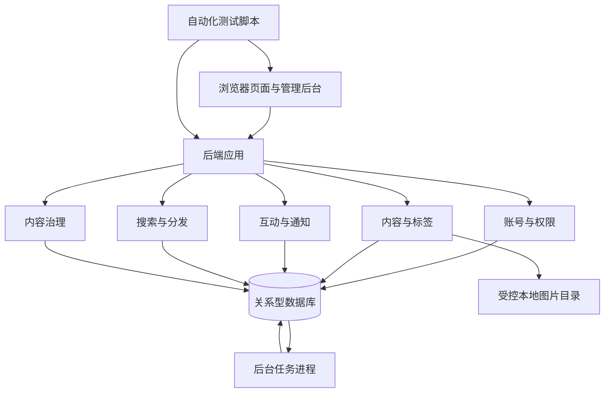

# 技术 UGC 博客社区 MVP 产品设计文档

| 项目 | 内容 |
| --- | --- |
| 项目名称 | Broker Blog（暂定） |
| 文档版本 | v0.3 |
| 更新日期 | 2026-10-15 |
| 文档状态 | 设计基线，待实现与脚本自动化验收 |
| 产品定位 | 面向技术用户的文章创作、阅读和交流社区 |
| 本期交付性质 | 不对用户开放的功能验证版本 |
| 验证方式 | 在隔离测试环境中，以脚本验证业务规则、接口和浏览器操作流程 |
| 参考产品 | CSDN、掘金；仅参考产品形态，不复刻完整功能 |

配套实施基线见 [MVP 技术方案](MVP技术方案.md)。本文定义产品行为与验收范围，技术方案记录已确认的选型和实现边界；两者变更时需同步检查。

## 1. 背景与目标

### 1.1 产品背景

产品提供技术文章的创作、发布、检索和交流能力。本期 MVP 产出后只能进行脚本自动化功能测试，暂时无法开放给真实用户使用，也无法收集用户反馈或开展冷启动运营。

本稿以“中文技术文章为主、桌面创作与移动阅读并重”作为界面与测试样例的设计假设。作者、读者和管理员均由测试账号模拟，不要求招募真实用户、准备运营团队或证明市场需求。

本期完成的含义是：规定范围内的功能能够运行，权限与状态符合规则，自动化用例可以重复执行并留下可追踪结果。自动化通过不代表已验证用户需求、真实使用体验、业务增长、生产容量或正式上线条件。

### 1.2 MVP 目标

1. 脚本能够模拟作者完成注册、草稿保存、发布、修订和删除。
2. 脚本能够模拟读者完成内容发现、点赞、收藏、评论、关注及通知查看。
3. 脚本能够模拟管理员完成举报处理、内容下架、复核、账号封禁与解封，并验证权限和审计记录。
4. 在断网、会话过期、重复提交、并发修改和后台任务重试等场景下，系统按明确规则处理，既不丢失已确认保存的内容，也不泄露非公开内容。
5. 提供可初始化、可隔离、可重复运行的测试环境与数据，并输出关联代码版本的测试报告。

核心功能链路：**创作 → 发布 → 内容发现 → 阅读与互动 → 通知与再次编辑**。治理链路覆盖下架、修订、复核和恢复公开。

### 1.3 非目标

本期不包含付费文章、课程、资源下载、广告交易、企业账号、私信、积分商城、复杂等级体系、AI 写作、协同编辑、个性化机器学习推荐或微服务拆分。

本期不建设业务数据指标、用户行为埋点、增长看板、阅读时长统计、转化或留存分析、A/B 实验。不开展用户招募、种子作者运营、内容冷启动、用户访谈或公开试用，不以这些工作作为开发前置条件或验收门槛。

正式邮件送达、真实域名与公网部署、生产压测、生产值守、面向真实用户的政策文本和服务承诺，均留待未来决定对外开放时单独规划。

### 1.4 文档术语与范围边界

- “公开文章”“公开接口”表示业务权限允许游客读取，访问仍限于本期隔离测试环境，不表示已向互联网开放。
- “发布”表示文章进入已发布状态；“MVP 交付”表示功能与自动化验收完成，两者均不等于正式上线。
- 点赞数、收藏数、评论数、关注数和通知未读数属于功能展示状态，保留并测试其正确性；不建设浏览量计数或其他行为统计。
- 错误日志、管理审计、后台任务状态和测试报告用于功能定位与验证，不属于用户行为分析。

## 2. 角色与场景

| 角色 | 核心需求 | 自动化模拟场景 | 产品响应 |
| --- | --- | --- | --- |
| 技术作者 | 稳定保存并发布内容 | 编写排错文章、恢复草稿、修订已发布文章 | Markdown、草稿保存、发布、修订、通知 |
| 技术读者 | 查找内容并保存 | 按关键词搜索、查看标签、收藏文章 | 搜索、标签、收藏列表 |
| 社区参与者 | 留言和维护关注关系 | 评论回复、关注与取消关注、查看通知 | 两层评论、关注列表、站内通知 |
| 管理员 | 按规则处理内容和账号 | 处理合成举报、下架、复核、封禁与解封 | 管理后台、举报队列、操作日志 |

作者和读者共用普通用户身份，不设作者申请门槛。除注册、登录及退出等会话操作外，业务写入必须登录且账号状态正常。测试账号与内容全部使用合成数据。

### 2.1 权限矩阵

| 操作 | 游客 | 普通用户 | 管理员 |
| --- | --- | --- | --- |
| 阅读公开文章、搜索、浏览主页 | 支持 | 支持 | 支持 |
| 发布、编辑文章 | 不支持 | 仅自己的文章 | 不直接修改他人正文；可以下架 |
| 点赞、收藏、关注、评论、举报 | 登录后继续 | 支持 | 支持 |
| 查看草稿和收藏 | 不支持 | 仅自己的内容 | 无常规浏览他人私有草稿入口 |
| 查看本人举报记录 | 不支持 | 支持 | 可通过治理权限查看待处理举报 |
| 删除评论 | 不支持 | 仅自己的评论 | 可隐藏违规评论 |
| 精选文章、处理举报、封禁账号 | 不支持 | 不支持 | 支持并留痕 |
| 查看下架内容、审核送审版本 | 不支持 | 仅本人下架内容与复核记录 | 通过治理入口查看下架内容和固定送审版本 |

管理员对送审版本的访问不意味着可以读取作者后续未提交的工作草稿。权限必须由服务端检查。

封禁用户不能新增、修改或删除内容，不能进行互动、举报或申请复核；可阅读公开内容、只读查看本人已有内容及处理原因、查看本人通知和举报记录、退出登录。历史文章是否下架由管理员另行处理，不随封禁自动批量删除。

## 3. 版本范围与优先级

P0 为本次功能验证版本必须实现并通过自动化验收的范围；P1、P2 为候选扩展，不属于本次交付承诺。后续是否实施另行确定，不依赖当前无法获取的真实用户数据。

| 领域 | P0：本次功能验证版本 | P1：候选扩展 | P2：更远期扩展 |
| --- | --- | --- | --- |
| 账号 | 邮箱格式、密码与图形验证码校验、资料、退出、账号状态、受限脚本重置密码 | 邮箱归属验证、邮件服务、自助找回密码、第三方登录、账号注销自助流程 | 机构账号、认证、复杂权限 |
| 创作 | Markdown、预览、代码高亮、图片上传、草稿及本地恢复、发布、修订、删除 | 完整版本历史、专栏、定时发布 | 协作编辑、内容付费 |
| 分发 | 精选、最新、标签列表、作者主页 | 关注流、同标签推荐 | 个性化推荐 |
| 搜索 | 关键词检索、相关性与最新排序、固定样例验收 | 联想词、纠错、筛选增强 | 语义搜索、个性化排序 |
| 互动 | 点赞、收藏、两层评论、关注及关注/粉丝列表 | 收藏夹、评论排序 | 私信、群聊、激励体系 |
| 通知 | 评论、回复、新关注、治理与复核结果、未读状态 | 通知偏好、通知聚合 | 邮件或其他渠道推送 |
| 治理 | 举报及本人记录、下架、隐藏评论、固定版本复核、封禁、审计 | 审核辅助、对治理决定的申诉工作流 | 信用体系、复杂反作弊 |
| 验证与诊断 | 展示计数、错误日志、任务状态、合成测试数据、接口与浏览器自动化 | 扩展浏览器兼容性及专项验证 | 另行规划 |

P0 保留关注关系与列表，用于验证完整的关系维护和通知规则；关注内容信息流仍为 P1。点赞不产生通知。

P0 的“复核”仅指作者修改下架文章后提交固定内容、管理员决定是否恢复公开；对原处理决定提出异议的申诉流程属于 P1。业务分析与运营能力不因本期完成而自动进入后续开发计划。

## 4. 信息架构与页面设计

### 4.1 全站结构

桌面顶部导航包含首页、搜索、写文章、通知和用户菜单。移动端保留相同核心能力，折叠次要操作；阅读、搜索和互动优先适配手机，编辑器支持基本操作。

| 页面 | 建议路径 | 核心内容与操作 |
| --- | --- | --- |
| 首页 | `/` | 精选/最新切换、文章列表、标签入口、写文章入口 |
| 标签页 | `/tags/:slug` | 标签简介、该标签下最新文章 |
| 搜索页 | `/search?q=` | 搜索词、结果数、排序、分页、空结果提示 |
| 文章详情 | `/articles/:id` | 标题、作者、时间、标签、正文、互动区、评论区 |
| 作者主页 | `/users/:id` | 头像、昵称、简介、公开文章、关注按钮、关注/粉丝列表 |
| 登录与注册 | `/login`、`/register` | 邮箱、密码、图形验证码及刷新、错误提示、返回原页面 |
| 编辑器 | `/editor/new`、`/editor/:id` | 新草稿入口、标题、正文、预览、保存状态、本地恢复、发布入口 |
| 内容管理 | `/me/articles` | 草稿、已发布、已下架列表；修订标识、下架原因、复核状态和操作 |
| 我的收藏 | `/me/bookmarks` | 私有收藏列表、取消收藏、失效内容提示 |
| 我的举报 | `/me/reports` | 本人举报、待处理/已处理状态、可公开的结果说明 |
| 个人设置 | `/settings/profile` | 头像、昵称、简介 |
| 通知中心 | `/notifications` | 消息列表、未读标识、全部已读 |
| 管理后台 | `/admin` | 内容、用户、举报、复核、标签、精选及操作记录 |

用户菜单包含内容管理、我的收藏、我的举报、个人设置和退出入口。封禁状态下保留允许的只读入口。

### 4.2 关键页面要求

**首页文章卡片：** 展示标题、摘要、作者、首次发布时间、标签和基础互动计数；封面非必填。精选为空时回退到最新文章；全站没有文章时展示明确空状态与写文章入口，不伪造示例内容。

**文章详情：** 正文优先，代码块支持复制和横向滚动；桌面展示目录，移动端目录可折叠。提供稳定链接、浏览器标题、描述信息和可抓取正文。修订后原链接不变，同时显示更新时间。

**编辑器：** 区分“有未同步修改 / 正在保存 / 已同步服务器 / 保存失败 / 版本冲突”。本地备份成功不能显示为已同步服务器。发布配置集中填写摘要和标签。

**内容管理：** 已发布文章如有未发布修订，显示“有未发布修改”；已下架文章展示原因和独立的复核状态。工作草稿与送审内容使用明确标识，避免把后续编辑误认为已经送审。

**通用状态：** 列表覆盖加载、空数据、失败重试和分页；表单覆盖校验失败、提交中和提交失败。登录过期后保留编辑内容，重新登录仍可恢复。按钮禁用与结果反馈可由自动化脚本读取。

**基本可用性：** 主要操作支持键盘，表单有可识别标签，状态和错误信息有文字，不能只靠颜色区分。提供稳定的角色、名称或测试标识供浏览器脚本定位。

## 5. 核心流程

### 5.1 首次发布

1. 点击写文章；未登录则进入登录/注册，成功后返回新草稿入口。
2. 输入标题和正文，生成本地恢复副本并创建私有服务器草稿。重试创建不能生成重复草稿。
3. 自动保存工作内容；点击发布时填写或确认摘要与标签。
4. 提交前确认当前内容已成功保存；发布请求绑定确认的草稿版本，校验账号、权限、状态、字段、标签和正文安全性。
5. 发布成功后进入详情，文章进入最新列表、标签页、作者主页和搜索。
6. 保存或发布失败保留当前内容并显示原因；重复发布请求返回一致结果，不创建重复文章。

### 5.2 阅读与互动

1. 从首页、搜索、标签或分享链接进入文章。
2. 游客点击互动操作时进入登录，保留返回位置。登录后返回原位置，互动操作由用户再次确认，不自动提交评论。
3. 点赞、收藏、关注可设置或取消，服务端按目标状态处理，安全支持重试。
4. 评论或回复成功后展示，并创建符合接收规则的通知。
5. 点击通知进入文章并定位对应评论；目标位于后续分页时仍能定位，内容不可用时显示明确提示。

### 5.3 举报与治理

1. 登录用户对已发布文章或可见评论选择原因并提交举报，可补充说明。
2. 同一用户对同一对象最多有一份待处理举报；重复请求返回已有记录。
3. 管理员查看上下文，选择驳回举报、下架文章或隐藏评论；封禁账号是独立操作。
4. 必须填写处理原因。内容状态、举报结果、审计及必要通知事件一致提交。
5. 处理结果立即作用于游客可访问的详情、列表与搜索。作者通过系统通知查看处理说明，举报人通过“我的举报”查看处理状态与可公开的结果。
6. 举报对象已删除或已被处理时，管理员仍可按实际状态结案并说明原因，不恢复对象，也不重复执行处罚。

### 5.4 下架文章修订与复核

1. 作者在内容管理中查看下架原因，修改工作草稿并保存。
2. 提交复核时固定送审内容，包括标题、正文、摘要、标签、图片引用及草稿版本；每篇文章最多有一份待处理复核。
3. 提交后作者可继续编辑工作草稿，后续修改不改变已送审内容。需要改送审内容时，先撤销再重新提交。
4. 管理员审核固定的送审内容，通过或驳回均填写原因。通过时仅发布该份内容；后续工作草稿继续保留为未发布修订。
5. 驳回后文章仍下架，作者可继续修改并重新提交。撤销后仍下架。
6. 作者删除文章时终止待处理复核。已删除、已撤销、已结案的旧复核请求不能再次恢复文章。

## 6. 功能详细需求与验收标准

以下默认参数作为本期自动化验收依据，应集中配置。调整参数时同步更新测试配置与边界用例，不依赖真人体验确认。

### 6.1 账号与资料

采用邮箱、密码与图形验证码注册和登录。不发送验证邮件，不部署测试邮件接收器。邮箱只检查格式与唯一性，不证明归属，界面不得标记为“邮箱已认证”。图形验证码用于限制自动化提交，不代替密码或邮箱归属验证。

- 注册时邮箱格式合法、邮箱未被使用、密码符合规则且图形验证码正确，才创建普通账号；登录时邮箱、密码和图形验证码均须通过校验。不存在的邮箱不能通过登录自动创建账号。管理员由受限初始化脚本预置，注册不能指定管理员身份。
- 密码仅保存带盐的安全哈希，不保存明文或可逆密文。密码长度规则、会话有效期与限流阈值在阶段 A 集中配置并加入边界用例，不能在测试中取消校验。
- 图形验证码随机生成，服务端校验；默认有效期 10 分钟、最多尝试 5 次，成功验证后消费，刷新使被替换的旧挑战失效。挑战与发起的浏览器会话及注册/登录用途绑定，不能跨会话或用途使用。
- 获取/刷新验证码、注册和登录分别限流。答案不能作为普通接口字段、图片替代文本或可直接读取的页面文本返回，不进入日志和测试报告；自动化通过第 7.4 节限定的内部适配器获取答案。
- 使用数据库会话和 HttpOnly Cookie；退出使原会话失效，每次业务请求检查当前账号状态，写接口实施 CSRF 保护。
- 本期不提供自助找回密码。受限本地管理脚本可重置测试账号密码，并撤销该账号已有会话；不得提供仅凭邮箱重置密码的公开接口。
- 昵称 2–30 个字符，简介最多 200 个字符；头像有默认值。昵称可重复，用户 ID 是稳定标识。
- 登录后返回本站原页面；不允许通过返回地址跳转到任意外部站点。退出后原会话失效。
- 正式隐私说明、用户协议、账号数据处理服务与对外联系渠道不属于本期交付，不能用虚构的运营承诺填充界面。
- 验收：邮箱格式与重复注册、密码规则与错误密码、验证码错误/过期/复用/刷新/跨会话/超限、退出与重置后旧会话失效均有确定结果；私有页面拦截正确；封禁用户直接请求写接口也被拒绝。图形验证码验收验证功能，不代表已验证抵抗机器识别的能力。

### 6.2 编辑与草稿

- 使用 CodeMirror 6 编辑 Markdown，支持常用语法、表格、列表、链接、图片、引用与代码块；桌面可并排编辑与预览，移动端切换。预览和公开正文使用 react-markdown 及一致的渲染与安全规则，禁用用户嵌入 HTML，支持代码高亮。
- 标题最多 100 个字符，正文最多 100,000 个字符；发布时均不能仅包含空白。文本长度按 Unicode 码点计算，前后端采用一致规则。
- 输入停止 3 秒后自动保存，持续输入时最长每 30 秒保存一次；支持手动保存。新草稿创建与后续更新均支持请求防重。
- 保存请求携带版本号；旧版本不得覆盖新版本。发生冲突时暂停自动提交，保留当前文本，提供复制/导出本地修改、载入服务器版本的操作。
- 输入后最长 1 秒将本地恢复副本写入 IndexedDB。副本按用户、文章或临时草稿标识、编辑会话隔离；同一文章不同窗口的未同步副本分别保留，不得被另一窗口的备份或载入操作覆盖。服务器暂不可达时仍可保存正文，副本记录时间与基础版本，不保存会话凭证。
- 刷新后如存在未同步副本，提示恢复或放弃，不能静默覆盖服务器内容。恢复后再次保存仍需校验版本。会话过期保留副本，重新登录同一账号后可恢复；其他账号不能通过界面读取。主动退出清除该账号的本地副本。
- 断网恢复指离线期间已写入本地副本，在网络恢复、页面可重新加载并确认身份后找回内容；本期不要求离线加载整个应用。
- 本地存储不可用或写入失败时明确提示，并提供复制/导出；不得宣称已备份。存在未同步内容时离开页面给出提醒。
- 图片支持 JPEG、PNG、WebP，单张最多 5 MB；检查真实类型与大小，上传失败可重试。不开放任意附件上传。
- 未完成上传的图片不能被发布或提交复核；本地草稿恢复不保证恢复尚未上传的文件本体，应提示重新选择文件。
- 验收：确认保存的草稿刷新后恢复；断网不显示已同步；本地备份完成后刷新可找回文字；多页面冲突可导出原文；重新登录后可恢复；他人无法读取或修改草稿。

### 6.3 发布与内容状态

- 每篇文章选择 1–3 个有效预置标签；摘要最多 200 个字符，未填写时从正文生成可编辑摘要。
- 已发布内容与工作草稿分开保存。作者确认发布或更新时必须指定已保存版本，后台不得读取一个随后已变化的草稿作为发布内容。
- 首次发布时间保持不变，修订只更新内容和更新时间。P0 不支持作者将已发布文章撤回为草稿。
- 删除需二次确认，采用逻辑删除，界面无恢复入口；本期仅在隔离测试环境的数据清理中物理移除，生产保留周期另行规划。
- 下架文章只能通过第 5.4 节的复核流程恢复。管理员不能直接修改作者正文。
- 发布、删除、下架与复核均校验当前文章状态并保证原子性；相互冲突的操作不能同时按旧状态成功。

| 当前文章状态 | 操作 | 结果文章状态 | 游客可访问 |
| --- | --- | --- | --- |
| 草稿 | 作者发布指定版本 | 已发布 | 是 |
| 已发布 | 作者确认更新指定版本 | 已发布 | 是，展示确认版本 |
| 已发布 | 管理员下架 | 已下架 | 否 |
| 已下架 | 作者提交、撤销复核或管理员驳回 | 已下架 | 否 |
| 已下架且复核待处理 | 管理员通过固定送审版本 | 已发布 | 是 |
| 草稿/已发布/已下架 | 作者删除 | 已删除 | 否 |

复核状态独立于文章状态：

| 当前复核状态 | 操作 | 结果复核状态 | 约束 |
| --- | --- | --- | --- |
| 无待处理复核 | 作者提交 | 待处理 | 文章下架、作者账号正常、固定送审内容有效 |
| 待处理 | 管理员通过 | 已通过 | 文章仍下架、作者账号正常、送审标签仍有效 |
| 待处理 | 管理员驳回 | 已驳回 | 必须填写原因，文章保持下架 |
| 待处理 | 作者撤销 | 已撤销 | 文章保持下架 |
| 待处理 | 作者删除文章 | 已终止 | 同时删除文章，旧请求不得恢复 |
| 已驳回/已撤销 | 作者再次提交 | 新建待处理记录 | 保留原记录，重新固定送审内容 |

作者被封禁或送审标签失效时，通过操作被拒绝且保持待处理，管理员可驳回并说明原因；解封或其他条件恢复后可重新按现状处理。已结案的复核不可再次变更结果。

验收：非公开文章不出现在游客详情、列表、搜索、站点地图和可抓取正文中；送审 A 版后编辑 B 版，通过仅公开 A 版并保留 B 版；删除一旦成功，旧复核请求不能恢复文章。若复核先完成，删除须重新校验当前状态；冲突失败需明确提示并允许重试，不得误报删除成功。

### 6.4 分发与搜索

- 最新列表按首次发布时间倒序，同一时间以文章 ID 稳定排序；更新不提升最新列表位置。
- 精选由管理员选择和排序，仅展示已发布文章。下架自动停止展示；复核恢复后不自动恢复精选资格。
- 标签页与作者主页只展示已发布文章，支持分页。
- 搜索覆盖标题、标签和正文，默认相关性排序，提供最新排序；相同词项在其他条件相同时，标题匹配优先于标签，标签优先于正文；同分使用发布时间和 ID 稳定排序。
- 首版使用关键词包含匹配：中文匹配连续片段，英文忽略大小写；去除查询首尾空白后按空白拆词，每个词都必须至少命中标题、标签或正文之一，可以跨字段命中。错误码按字面匹配，查询中的 `%`、`_` 等不得成为数据库通配符。暂不提供同义词理解或错别字纠正；多词评分的具体公式在实现前写入版本化样例，遵守字段优先级。
- 空词显示输入提示，无结果显示空状态；结果摘要经过安全处理。
- 使用合成中文技术文章、英文框架名、缩写、错误码和混合关键词组成固定查询集，记录预期文章 ID、排序约束和不可出现的文章 ID。
- P0 同库检索读取当前状态，不依赖外部搜索服务。匹配规则须由测试样例约束，不以真实用户点击或搜索统计验收。
- 验收：发布或更新后可检索新内容，下架删除后立即不可检索；静态数据集跨页不重复且不遗漏。翻页期间新增文章不应导致已经展示的条目再次出现，采用稳定游标或等效方案；不承诺搜索结果在并发修改时形成历史快照。

### 6.5 点赞、收藏与关注

- 点赞和收藏按“用户 + 文章”唯一；请求表达目标状态，重复设置和取消均可安全重试，不使用无法安全重试的盲目切换语义。
- 仅允许对已发布文章新增点赞或收藏；失效关系允许正常账号取消。
- 收藏列表仅本人可见，文章不可用后显示失效占位并允许取消，不返回原正文或摘要。
- 不允许关注自己；关注关系按“关注者 + 被关注者”唯一。关注和粉丝列表支持分页，P0 不提供关注文章信息流。
- 点赞数、收藏数、关注数以关系记录为依据；评论数统计未删除、未隐藏的评论与回复，不包含占位记录。取消后计数不能为负数。
- 本期写入完成后刷新应读取正确计数，不要求跨页面实时推送。
- 验收：重复或并发请求不产生重复关系；刷新后的按钮状态和展示计数与事实记录一致；收藏不可越权读取。

### 6.6 评论与回复

- 评论为纯文本，长度 1–2,000 个字符，不能仅包含空白；不支持图片、附件和富文本。
- 展示为顶层评论与回复两层；回复其他回复仍归属原顶层评论，并标注被回复用户。
- 顶层评论按时间倒序，回复按时间正序；同一时间用 ID 稳定排序，均支持分页。
- 用户只能删除自己的评论；作者不能删除他人评论，需举报处理；管理员可以隐藏违规评论。
- 顶层评论删除或隐藏后保留占位，合法回复仍可阅读；原正文不再通过游客接口返回。
- 不允许新增回复指向已删除或隐藏的目标，已有合法回复仍保持原层级。文章不可用后不允许新增评论，原评论也不通过游客文章接口提供。
- 相同提交标识的评论重试只生成一条评论及一份相关通知事件。
- 验收：根评论和回复目标必须属于当前文章；空白输入、重复提交、删除后的回复目标和跨文章挂载均有确定处理。

### 6.7 通知

| 触发事件 | 接收者 | 点击目的地 |
| --- | --- | --- |
| 新顶层评论 | 文章作者 | 文章对应评论 |
| 新回复 | 被回复评论的作者 | 对应回复 |
| 新关注 | 被关注用户 | 关注者主页 |
| 内容下架或评论隐藏 | 被处理内容的作者 | 内容管理页或处理说明 |
| 复核通过或驳回 | 提交复核的作者 | 内容管理中的复核记录 |

- 自己的操作不通知自己；新回复不额外通知文章作者。
- 重试同一事件不重复通知；一次真实取消后再次关注属于新事件，可产生新通知。
- 支持单条已读、全部已读和未读数量；采用普通接口加载，无需长连接。“全部已读”只作用于请求处理时已存在的通知，之后的新通知仍未读。
- 后台任务持久化并可重试，通知按事件与接收者去重；失败任务可查询与重试。
- 验收：事件处理完成后通知数量、对象、跳转和未读状态正确；失效目标仍有安全说明，不泄露违规正文；用户只能查看和修改本人的通知。
- 举报人通过“我的举报”获知结果，本期不额外发送举报结果通知。

### 6.8 举报与管理后台

- 我的举报：显示提交时间、对象类型与标识、待处理/已处理状态、可公开的处理说明；仅本人可见，不返回被隐藏正文、管理内部备注或其他举报人的信息。
- 内容管理：按标题、作者、状态查询，查看有权限访问的内容，执行下架、复核和精选。
- 复核管理：展示固定送审内容、版本、提交时间和处理记录；通过和驳回需原因，不得显示后续未送审草稿。
- 用户管理：查询用户和账号状态，封禁与解封需确认及原因。
- 举报管理：按对象和状态筛选、查看治理上下文，处理结果可追溯。相同处理请求重试不得重复处罚或生成重复审计。
- 标签管理：新增、改名、停用。名称修改不改变稳定 slug；已使用标签不物理删除。停用后既有文章仍可显示和按标签访问，新的发布、更新和复核提交须使用有效标签。
- 管理日志：记录操作者、目标、动作、时间和原因；普通管理员不能修改或删除日志。
- 验收：非管理员访问管理接口被拒绝；每次成功治理操作有对应审计；举报者离开页面并重新登录后仍能查看结果；治理立即影响所有游客可见入口。

## 7. 后端与可测试性设计

### 7.1 总体架构

采用模块化单体：TypeScript、React 与 Next.js 提供页面和业务接口，PostgreSQL 为唯一业务数据库，Drizzle 管理数据访问和版本化迁移，复杂查询允许使用参数化 SQL。图片保存在受控的服务器本地磁盘，替换 v0.2 的独立对象存储要求。后台任务使用数据库任务表与独立工作进程，共用业务模块，不引入独立缓存或消息队列。游客文章页服务端输出正文；正文、列表、搜索和媒体读取按请求检查当前状态，避免缓存导致下架内容仍可访问。

技术选型已确认，细节见 [MVP 技术方案](MVP技术方案.md)。日常开发时应用、任务进程、PostgreSQL 和全部依赖在 Windows 原生运行，不要求 WSL 或容器参与日常开发；Linux 容器用于完整验收与后续部署，由 Docker Compose 管理。所有环境必须支持无交互启动、迁移、数据初始化和测试执行，测试运行真实业务模块及真实文件读写。

### 7.2 核心实体

| 实体 | 关键内容 | 约束 |
| --- | --- | --- |
| 用户 | ID、邮箱、密码哈希及算法参数、昵称、头像、简介、状态、角色 | 邮箱唯一，不代表邮箱已验证；权限由后端验证 |
| 会话/图形验证码 | 用户或浏览器会话、用途、有效期、撤销或消费状态、尝试次数 | 凭证及答案校验材料安全保存，不进入日志；验证码按挑战隔离 |
| 文章 | 作者、已发布内容、摘要、状态、首次发布时间、更新时间、状态版本 | 归属不可篡改，状态变化检查并发 |
| 修订草稿 | 文章 ID、完整工作内容、版本、保存时间 | 每篇文章一份当前草稿，保存检查版本 |
| 复核申请 | 文章、固定内容快照、来源草稿版本、状态、提交人、处理人、原因、时间 | 快照不可变，每篇文章最多一份待处理申请 |
| 标签及关联 | 名称、稳定 slug、状态、文章关联 | 关联唯一，发布时检查有效性 |
| 评论 | 文章、作者、根评论、回复目标、正文、状态、提交标识 | 关系合法，重复提交不新增 |
| 点赞/收藏 | 用户、文章、创建时间 | 用户与文章联合唯一 |
| 关注 | 关注者、被关注者、创建时间 | 关系唯一，禁止自关注 |
| 通知 | 接收者、事件、目标、已读状态 | 事件与接收者联合去重 |
| 举报 | 举报者、对象、原因、状态、处理结果、可公开说明 | 同人同对象最多一份待处理举报 |
| 媒体对象 | 所有人、媒体 ID、内部文件键、类型、大小、上传状态、内容或头像引用 | 文件保存在受控本地目录；访问取决于归属与当前有效公开引用 |
| 精选配置 | 文章、顺序、操作者 | 只展示有效公开内容 |
| 管理日志 | 操作者、目标、动作、原因、时间 | 不允许普通业务操作覆盖 |
| 后台任务/事件 | 类型、载荷、重试次数、处理状态 | 可持久化、可重试、消费幂等 |

本地恢复副本保存在浏览器，独立于服务器草稿版本。本期不新增用户行为事件表、分析仓库或统计报表实体。

### 7.3 一致性与安全

- 发布内容、标签关联与必要任务事件在同一事务中提交。治理结果、状态、审计与通知事件也要保持一致。
- 点赞、收藏、关注以关系记录为事实来源；重复请求、并发请求和取消操作遵守唯一约束。
- 搜索、列表、正文输出和媒体访问均依据当前公开状态，不能因直接访问 ID 或旧链接绕过权限。
- 过滤 Markdown 渲染中的危险脚本、链接协议和 HTML；搜索摘要与评论按各自输出规则处理。
- 写入检查身份、账号状态和资源归属，按认证方式配置 CSRF 等保护；本期用例需验证对应机制。
- 图片目录位于公开静态目录之外，不开放目录枚举，不由静态服务器直接映射。媒体通过受控访问入口提供；被有效已发布内容或已确认保存的公开头像引用的图片可供游客读取，其他图片仅所有者或有相应治理权限的管理员可读。外部只使用媒体 ID，不接受用户指定服务器文件路径；解析后的路径必须限制在配置的存储根目录内。
- 管理员仅可读取其有权审查的下架内容或固定送审版本引用的私有媒体，不能读取未送审工作草稿的其他图片。发布、更新、送审与头像保存都校验引用权限，不允许通过引用他人的私有图片使其公开。
- 草稿图片上传成功不等于公开；文章下架或删除后重新访问图片须重新判断权限。仍被其他有效公开内容引用的图片可继续公开，已经下载到客户端的内容不在撤回保证范围。
- 图片通过已认证、受 CSRF 保护的应用接口上传，由服务端生成内部文件键并检查真实格式、大小与所有者，不使用对象存储直传凭证。只有文件已可靠写入且媒体记录完成后才能确认上传成功；失败不得生成可发布引用。登录、上传、评论和搜索配置限流。
- 日志不得记录密码、验证码答案、会话凭证或完整私人正文；测试报告也应避免附带这类敏感内容。

### 7.4 自动化控制边界

- 图形验证码仍随机生成；测试通过仅测试环境启用的受限内部适配器获取本次挑战答案，再经真实页面或接口提交邮箱、密码和验证码。答案不通过普通业务接口、页面文本或日志暴露。禁止固定万能验证码、测试请求头绕过校验或跳过登录。
- 时间、验证码生成失败、文件读写失败和任务重试可在测试进程或隔离适配器中控制，不在普通业务接口暴露故障开关。
- 测试账号初始化、数据库检查、任务驱动和数据清理通过受限测试入口或脚本执行，不提供游客可访问的管理后门。
- 非测试配置不得启用测试控制入口。初始化和清理脚本必须校验测试环境及数据命名空间，不能指向非测试数据库或存储。
- 异步用例等待明确任务完成条件，并设置超时；不能仅依赖固定长时间等待判定成功。

## 8. 本期非功能要求

| 项目 | 自动化验证要求 |
| --- | --- |
| 可重复运行 | 从干净测试环境初始化后可执行完整用例；重复执行不依赖上次残留数据 |
| 运行与持久化 | 有健康检查；应用与任务进程重启后已确认提交的内容、关系和待处理任务仍存在 |
| 移动与桌面布局 | 默认验证 1440 × 900 和 390 × 844 两种视口；核心按钮可见可操作，页面主体不横向溢出，代码块可独立滚动 |
| 键盘与语义 | 核心表单与操作可由键盘完成，输入标签、状态及错误文字可被自动化定位与断言 |
| 故障诊断 | 记录请求标识、错误类型、任务状态和必要耗时，便于关联失败用例；不要求生产告警或值守 |
| 内容输出 | 未执行客户端脚本时，已发布文章响应包含正文、标题与摘要；非公开内容不在响应或站点地图中 |
| 数据隔离 | 草稿、邮箱、收藏、举报及本地恢复副本按规定隔离；所有测试使用合成数据 |
| 浏览器基线 | P0 使用固定版本的 Chromium 自动化；版本写入测试配置和报告，其他引擎不作为本期门槛 |

本期不设置生产吞吐量、P95 性能、RPO/RTO、搜索收录或真实设备体验的交付门槛。脚本超时用于识别测试失败或挂起，不作为生产性能承诺。截图与运行轨迹用于定位失败，不要求人工视觉评审才可完成本期验收。

## 9. 脚本自动化验收设计

### 9.1 验证层次

| 层次 | 主要验证内容 | 要求 |
| --- | --- | --- |
| 规则与组件测试 | 长度边界、状态迁移、权限判定、渲染安全、排序与去重规则 | 固定输入与预期输出，可控制时间 |
| 接口与持久化测试 | 真实认证、资源归属、并发、事务、任务、对象访问、重试 | 使用真实后端与测试数据库，不以伪造业务成功响应代替验证 |
| 浏览器端到端测试 | 页面入口、填写与提交、反馈、恢复、跨页面状态、移动布局 | 通过真实页面连接测试后端，覆盖完整角色链路 |

规则与组件测试使用 Vitest；接口与浏览器流程使用 Playwright。持久化相关用例连接真实 PostgreSQL 和本轮专属文件目录。日常测试可在 Windows 原生运行，全量交付验收在 Linux 容器执行，Chromium 及工具版本固定并写入报告。

浏览器网络故障模拟可用于验证失败状态，但核心成功流程必须实际落库；单独验证页面显示“成功”不足以通过验收。关键写入至少从后续读取接口或页面独立验证，必要时核对数据库约束。接口层覆盖规则与权限组合，浏览器层重点覆盖完整链路及页面行为，无需将所有规则机械地重复为浏览器用例。

### 9.2 核心用例矩阵

以下编号作为需求与自动化用例的追踪依据；每行可拆为多个成功、失败与边界子用例。

| 编号 | 功能场景 | 关键断言 |
| --- | --- | --- |
| AUTH-01 | 邮箱格式、重复注册、密码规则/错误密码、图形验证码刷新/错误/过期/复用/跨会话/超限、退出与脚本重置密码 | 密码和验证码均实际校验，限流生效，退出或重置后旧会话失效，返回地址安全；无邮箱已验证标记 |
| AUTH-02 | 游客、普通用户、资源所有者、管理员、封禁用户 | 页面与接口权限一致，直接请求不能越权或绕过封禁 |
| PROFILE-01 | 修改昵称、简介、头像及字段边界 | 本人资料正确保存与展示，默认头像可见，不能修改他人资料或引用他人私有图片 |
| EDIT-01 | 自动保存、手动保存、新草稿创建重试 | 到达配置时间正确保存，无重复草稿；服务端失败不显示已同步 |
| EDIT-02 | 断网编辑后恢复网络并刷新、登录过期、本地存储失败 | 已完成本地备份的文本可恢复，异常有导出途径，跨账号不可读取 |
| EDIT-03 | 两页面修改同一草稿、冲突后刷新、发布前版本变化 | 旧版本不能覆盖新版本；各窗口冲突副本均可恢复；不能误发布其他版本 |
| MEDIA-01 | 正常、伪造类型、超限、失败重试及未完成上传 | 文件规则生效，失败不误报成功，未完成文件不能发布 |
| MEDIA-02 | 草稿、已发布、下架、删除文章及头像的图片读取、路径越界与静态目录绕过 | 图片访问随有效引用变化，文件不能通过路径或静态地址绕过授权，管理员不可读取未送审私有媒体 |
| ARTICLE-01 | 发布、修订、重复提交、删除 | 链接与首次发布时间稳定，只有确认版本公开，无重复文章 |
| REVIEW-01 | 下架、送审、继续编辑、通过、驳回、撤销、再提交 | 审核固定快照，后续草稿不泄露，状态和通知正确 |
| REVIEW-02 | 删除与通过并发、重复结案、作者封禁、标签失效 | 已成功删除的文章不复活，冲突不误报成功，已结案记录不可重判，前置条件失效阻止通过 |
| DISC-01 | 首页空态、精选回退、最新、标签、作者主页、分页 | 只出现公开内容，排序稳定，翻页新增不重复已有条目 |
| SEARCH-01 | 固定中文、英文、缩写、错误码、混合词及空词 | 预期 ID 与排序约束匹配，更新后可查，下架删除后不可查 |
| INTERACT-01 | 点赞、收藏、关注设置/取消及并发重试 | 唯一关系、正确计数、不可自关注、收藏私有、失效占位可取消 |
| COMMENT-01 | 评论、回复、分页、删除、隐藏及重复提交 | 两层关系正确，非法目标被拒，原正文不泄露，合法回复保留 |
| NOTICE-01 | 触发规则、自身操作、三方回复、已读、全部已读、深链接 | A 发文、B 评论、C 回复 B 时，该回复仅通知 B；接收者、数量、未读状态和分页评论定位正确 |
| TASK-01 | 通知任务失败、通知写入后任务确认前中断、重启与再次执行 | 任务可恢复，同一事件不重复通知，最终状态可追踪 |
| TXN-01 | 发布/治理事务中途失败、业务提交成功但响应丢失 | 内容、关联、审计和事件无部分提交；已成功提交的请求重试不重复写入 |
| REPORT-01 | 举报防重、管理员处理、举报人重新登录查结果 | 本人可追踪结果，无其他举报信息或隐藏正文泄露 |
| ADMIN-01 | 下架、精选、封禁/解封、标签改名停用、审计 | 操作有原因和审计，游客入口一致，标签既有访问规则正确 |
| SECURITY-01 | 危险 Markdown/链接、私人内容、跨资源访问、限流 | 不执行危险内容，不泄露私有数据，相关保护机制生效 |
| UI-01 | 两种视口、键盘、加载/空态/失败/重试、长代码块 | 核心控件可操作，反馈可识别，页面无整体横向溢出 |
| OUTPUT-01 | 无客户端脚本的正文响应与站点地图 | 公开正文可读取，所有非公开文章被排除 |
| ENV-01 | 干净初始化、测试重跑、应用重启、配置隔离 | 结果不依赖运行顺序，已提交数据持久，测试控制不在非测试配置启用 |

### 9.3 执行与结果规则

- 每个用例明确前置数据、执行动作、预期状态和清理方式；报告中关联本表编号及具体子用例。
- 使用同一个已提交且无未提交业务变更的代码版本，在干净环境执行全量 P0 用例，再从重新初始化的环境执行一次；两次独立运行都通过才可交付。
- 失败、超时、未执行和跳过的必需用例均不能视为通过。重试需保留首次失败记录，不得以自动重跑掩盖不稳定；修复后重新执行受影响用例及完整验收。
- 并发场景通过受控的同步点发起冲突请求，断言允许的结果与最终状态，不能依靠偶然撞出竞态。
- 对时间规则使用受控时钟或可配置测试时间，覆盖阈值前、达到阈值和失效后；不能为了加速测试取消安全与版本检查。
- 输出机器可读结果及便于阅读的汇总，包含被测代码 commit、配置版本、浏览器版本、数据集版本、用例结果和失败原因；失败保留必要日志、截图或浏览器轨迹。报告作为独立运行产物保存；如另行提交报告，分别标明报告提交与被测代码提交，不要求报告引用自身 commit。
- 结果报告不作产品价值判断，不采集真实用户行为；全部通过仅表示本稿规定的功能验收通过。

## 10. 测试环境与合成数据

### 10.1 环境组成与运行入口

本期不提供对外体验地址。日常开发时应用、PostgreSQL、后台任务和测试执行器全部在 Windows 原生运行，图片使用隔离本地目录。完整验收在本地可用或受访问控制的 Linux 容器环境执行，由 Docker Compose 管理应用、数据库、任务进程和测试执行器，图片目录挂载持久化数据卷。未来目标为单台 Linux 服务器部署；准备容器不等于本期开放公网服务。不部署邮件服务或独立对象存储。

实施时需提供文档化的脚本入口：安装依赖、启动环境、执行迁移、初始化数据、受限重置测试账号密码、执行规则测试、执行接口测试、执行浏览器测试、执行全量验收、导出报告和清理本轮数据。脚本需兼容 Windows 与 Linux；命令在实现时确定，不预设当前仓库已具有实现。

每次运行使用唯一运行标识，隔离数据库或数据命名空间、文件目录、验证码内部适配器状态与后台任务。任务进程只能消费本次运行的任务。每次独立初始化还需重置测试时钟和故障开关，并使用全新浏览器上下文，隔离 cookie、IndexedDB 及缓存；草稿恢复用例仅在本用例内保留所需浏览器状态。

清理仅作用于已确认的本轮测试资源；清理失败需要报告，不能继续把环境当作干净环境。

### 10.2 基础数据集

| 数据类别 | 最少覆盖情况 |
| --- | --- |
| 用户 | 正常作者 A、正常读者/作者 B、正常参与者 C、管理员、封禁用户；游客为无会话访问 |
| 认证 | 格式非法/重复邮箱、密码边界与错误密码、有效/过期/已消费/刷新失效的图形验证码、跨会话挑战、撤销或过期会话 |
| 标签 | 多个有效标签、停用标签、改名但 slug 不变的标签 |
| 文章 | 草稿、已发布、已下架、已删除；同时间发布、无精选、长正文、长代码块、未发布修订 |
| 复核 | 待处理、通过、驳回、撤销、终止；送审后又编辑工作草稿 |
| 互动 | 有/无点赞收藏关注、重复关系请求、已失效收藏、顶层评论和多条回复 |
| 通知与任务 | 已读/未读、自身操作、失效目标、待执行、失败重试、重启后恢复 |
| 举报与审计 | 待处理、已处理、同人重复举报、对象已失效、本人及他人举报记录 |
| 媒体 | 有效图片、伪造类型、超限文件、未完成上传、私有引用、有效公开引用 |
| 边界文本 | 空白、最小/最大长度及超限、中文与英文、表情、危险 HTML 和链接 |
| 搜索样例 | 固定词项、预期命中文章 ID、明确的匹配优先级、禁止出现的非公开 ID |

数据必须由脚本生成或从版本化的合成样例导入，不依赖真实作者、真实邮箱、外部文章采集或真人维护内容。随机生成时记录固定种子，时间与排序条件可复现。列表数据量应超过配置页大小，以覆盖真正的分页与评论定位。

基础账号与边界状态可直接通过受限初始化脚本创建；注册、发布和治理流程用例仍必须通过对应业务入口生成状态，不能以预置最终结果替代流程验证。

### 10.3 故障与异步控制

- 在测试环境中可模拟断网、服务端保存失败、会话过期、验证码生成失败、上传或文件读写失败、本地存储失败、任务首次执行失败以及进程重启。
- 增加明确失败窗口：业务事务在内容、关联、审计或事件写入中途失败；业务已提交但响应丢失；通知已写入但任务尚未确认完成时中断。分别验证完整回滚、请求重试幂等和通知不重复。
- 不同用例分别隔离故障开关，运行结束后恢复，禁止向其他并行用例传播。
- 浏览器测试等待明确 UI 状态，后台测试等待对应任务/事件状态；失败超时输出关联标识和当前状态。
- 功能依赖的数据库使用真实 PostgreSQL，图片使用本轮专属目录中的真实文件读写，不以全量模拟替代持久化与权限验证。验证文件写入中断、文件已写但数据库登记失败，以及应用重启后的有效图片可读取；未完成文件不得被公开引用。

## 11. 开发阶段与交付门槛

| 阶段 | 交付内容 | 完成条件 |
| --- | --- | --- |
| A：基础与测试环境 | 已确认技术栈、Windows 原生运行与 Linux 容器、路由与页面骨架、密码及图形验证码认证、账号权限、迁移、受控文件目录、数据初始化与脚本入口 | 干净环境可启动，认证与权限基础用例可执行 |
| B：创作与阅读 | 草稿、本地恢复、媒体、发布修订、详情、内容管理、首页与标签 | 创作链路、恢复、版本冲突与媒体权限用例通过 |
| C：发现与互动 | 搜索、点赞、收藏、关注、评论、通知 | 固定检索集、关系防重、计数、评论与通知用例通过 |
| D：治理与完整验收 | 我的举报、管理后台、固定版本复核、审计、故障与并发用例 | 所有 P0 用例在干净环境通过，失败问题修复 |
| E：可复现交付 | 完整代码、配置示例、运行说明、合成数据、测试脚本与报告 | 同一被测代码 commit 在重新初始化后再次全量通过，报告记录该 commit |

本期不安排用户试用、运营冷启动、真实反馈收集或数据观察阶段。交付结束后是否进入 P1 由新的需求决定。具体开发周期在技术栈与人员投入确定后估算。

## 12. MVP 自动化验收清单

以下为待实现、待执行的交付清单；当前文档修订不表示功能已经实现或测试已经通过。

- [ ] AUTH-01/02：邮箱格式、密码、图形验证码、退出、脚本重置密码、角色权限和封禁规则通过，内部测试适配器没有绕过认证，非测试配置不能读取验证码答案。
- [ ] PROFILE-01：资料修改、头像展示、字段边界和归属校验通过。
- [ ] EDIT-01/02/03：草稿保存、断网恢复、登录过期、存储失败、多页面冲突和发布版本绑定通过。
- [ ] MEDIA-01/02：上传规则、失败状态及草稿/下架/删除媒体的访问权限通过。
- [ ] ARTICLE-01、REVIEW-01/02：发布、修订、删除、下架和固定版本复核通过，并发时已成功删除的文章不能恢复，冲突不误报成功。
- [ ] DISC-01、SEARCH-01：首页、标签、作者主页、搜索仅出现公开内容，固定样例与分页规则通过。
- [ ] INTERACT-01、COMMENT-01：互动关系、展示计数、评论层级和删除/隐藏规则通过。
- [ ] NOTICE-01、TASK-01：接收者、定位、未读状态、任务重试和重启恢复通过。
- [ ] TXN-01：事务中途失败完整回滚，提交成功后响应丢失的重试不重复写入。
- [ ] REPORT-01、ADMIN-01：举报结果入口、治理权限、标签规则和审计通过。
- [ ] SECURITY-01、OUTPUT-01：危险内容、越权、限流、非公开正文和站点地图隔离通过。
- [ ] UI-01：桌面与移动视口、键盘操作和通用异常状态通过脚本检查。
- [ ] ENV-01：Windows 原生运行、Linux 容器完整验收、测试控制隔离、初始化、数据库与图片持久化和重复运行通过。
- [ ] 同一被测代码版本的全量 P0 用例在两次独立初始化后均通过，必需用例没有跳过或未执行。
- [ ] 被测代码版本、数据与配置版本、脚本入口、报告及失败诊断方法完整可追溯；报告若另行入库，其提交标识单独记录。
- [ ] 当前交付没有引入业务埋点或统计看板，也不依赖用户招募、运营准备或外部真实服务。

## 13. 实施决策与后续边界

### 13.1 已确认决策与实施细化事项

| 项目 | 本稿约束 | 确定时机 |
| --- | --- | --- |
| 技术栈 | TypeScript、React、Next.js、PostgreSQL、Drizzle；CodeMirror 6、react-markdown、IndexedDB；Vitest、Playwright | 已确认；阶段 A 固定兼容版本 |
| 测试运行环境 | Windows 全部原生开发，Linux 容器完整验收及后续部署，Docker Compose 管理，不对外开放 | 已确认；阶段 A 实现入口 |
| 脚本与配置 | 无交互运行、配置与依赖版本固定、环境隔离 | 阶段 A |
| 认证与存储 | 邮箱格式、密码、图形验证码；数据库会话；受控本地磁盘图片；不需要邮件服务 | 已确认；阶段 A 细化参数 |
| 搜索匹配实现 | PostgreSQL 同库包含匹配，中文连续片段、英文忽略大小写、多词全部命中，标题优先标签和正文 | 已确认规则；阶段 C 实现前固定评分公式与样例 |
| 报告与产物 | 机器可读结果、可读汇总、失败诊断材料和 commit 标识 | 首批用例建立时 |
| 资源与工期 | 依据实际开发投入估算，不以生产容量或公开上线日期倒推 | 开发排期时 |

### 13.2 未来对外开放时另行规划

目标用户细分、价值验证、种子内容、运营责任、业务指标、真实服务供应商、正式政策文本、数据保留与账号处理、生产部署与容量、正式品牌等，均不作为本期阻塞项。

这些事项不预先设定日期，也不承诺本次 MVP 已满足。未来明确要开放使用时，再单独制定范围和验收要求。

### 13.3 v0.3 修订说明（2026-10-15）

- 固定技术选型，并新增配套技术方案；日常开发全部使用 Windows 原生环境，完整验收和后续部署使用 Linux 容器。
- 用邮箱格式、密码和图形验证码替换邮箱验证码认证，移除测试邮件接收器；补充数据库会话、受限密码重置和验证码内部测试适配器边界。
- 用受控本地磁盘替换独立对象存储，保留媒体引用权限、撤权、真实持久化和失败恢复要求。
- 确认 Markdown 编辑与预览组件、IndexedDB 恢复副本、搜索匹配规则及 Vitest/Playwright 分工。
- 同步认证、媒体、环境与故障验收；既有业务状态、一致性和两次干净环境完整验收门槛不降低。

### 13.4 v0.2 修订说明（历史）

- 将交付目标从真实用户试用调整为隔离环境中的脚本自动化功能验证。
- 移除业务指标、行为埋点、冷启动运营、用户反馈与生产上线作为验收前提的要求。
- 保留现有创作、阅读、互动与治理功能，并区分展示计数、技术诊断与业务分析。
- 补充草稿本地恢复、发布版本绑定、固定送审内容、独立复核状态及“我的举报”入口。
- 新增可追踪的自动化用例矩阵、合成数据、外部依赖替身、故障控制与可复现交付规则。
