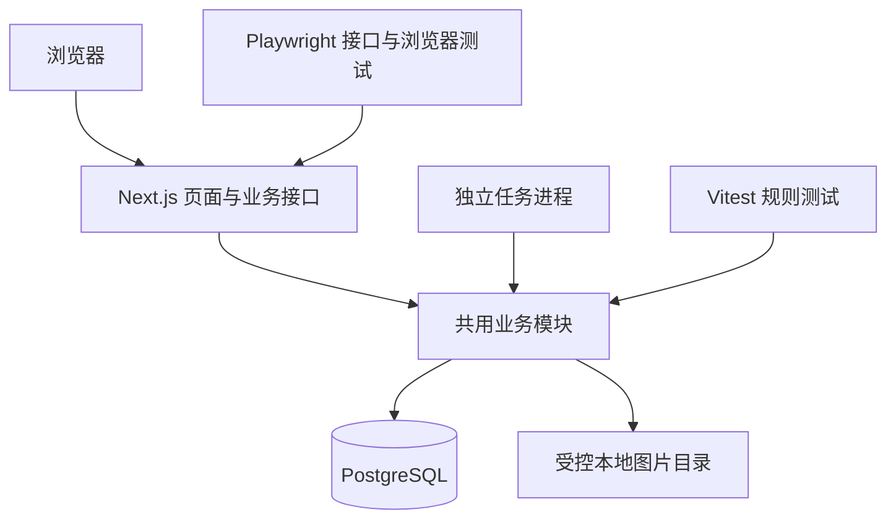

# Broker Blog MVP 技术方案

| 项目 | 内容 |
| --- | --- |
| 文档版本 | v1.2 |
| 更新日期 | 2026-10-15 |
| 对应产品基线 | [MVP 产品设计文档 v0.3](MVP产品设计文档.md) |
| 状态 | A1 开发环境、A2 数据库/事务/任务基础、A3 账号认证及 A4 页面骨架已实现；业务功能与全量验收待完成 |
| 选型目标 | 优先实现与验收效率，减少独立服务，保持业务规则可验证 |
| 开发环境 | 应用与全部依赖在 Windows 原生运行 |
| 验收与部署 | Linux 容器，Docker Compose 管理；后续单台 Linux 服务器部署 |

## 1. 范围与决策摘要

本方案记录技术讨论中确认的实施基线。产品行为、权限矩阵、状态迁移和验收编号以配套产品文档为准；本文补充实现结构、运行方式与技术约束。A1 环境已完成，版本与记录见[开发环境说明](开发环境说明.md)；A2 已落地首批迁移、事务、防重、持久任务与隔离验证，见[A2 实施说明](A2基础设施实施说明.md)。业务功能和完整自动化验收尚待后续阶段实施。

本期仍是隔离环境中的功能验证版本。准备 Linux 部署能力不等于公开上线，也不引入运营、生产容量或真实邮件送达要求。

| 领域 | 确认方案 | 选择理由与边界 |
| --- | --- | --- |
| 语言 | TypeScript | 页面、接口、任务与测试共用类型和校验规则；服务端仍独立验证输入 |
| 应用 | React + Next.js | 同一应用提供交互页面、业务接口和服务端文章正文 |
| 架构 | 模块化单体 + 独立任务进程 | 业务模块共用，任务可独立重启，不拆微服务 |
| 数据库 | PostgreSQL | 唯一业务数据库，承担事务、约束、搜索、会话与任务持久化 |
| 数据访问 | Drizzle + 版本化迁移 | 使用类型化查询；复杂搜索、锁和并发操作允许参数化 SQL |
| 认证 | 邮箱格式 + 密码 + 图形验证码 | 不发送邮件；邮箱不视为已验证；不允许邮箱直接登录 |
| 会话 | 数据库会话 + HttpOnly Cookie | 可撤销，检查实时账号状态，写接口实施 CSRF 保护 |
| 编辑器 | CodeMirror 6 | Markdown 源码编辑，桌面并排预览、移动端切换 |
| 正文渲染 | react-markdown | 预览与公开正文使用同一规则，禁用用户 HTML，支持代码高亮 |
| 草稿恢复 | IndexedDB | 按账号、文章或临时草稿、编辑窗口隔离副本 |
| 图片 | 受控本地磁盘 | 真实持久化，应用检查权限后读取，适配首次单机部署 |
| 搜索 | PostgreSQL 同库包含匹配 | 中文片段、英文忽略大小写、多词全部命中，按字段优先级排序 |
| 后台任务 | 数据库任务表 + 独立工作进程 | 业务事务内写事件，持久重试，通知去重 |
| 测试 | Vitest + Playwright | 规则测试、真实接口测试与固定 Chromium 浏览器测试 |
| 环境 | Windows 原生开发，Linux 容器验收与部署 | 保留开发习惯，在开发阶段验证 Linux 兼容性 |

本期不引入 Redis、外部搜索引擎、独立消息队列、邮件接收器或独立对象存储。A1 已通过 package.json、pnpm-lock.yaml 和开发环境说明固定当前基础依赖；后续引入编辑器等模块依赖时同样固定版本，不使用浮动版本作为可复现交付依据。

## 2. 应用结构与模块边界

业务划分为账号与权限、文章与草稿、媒体、搜索与分发、互动、通知与任务、治理与审计。路由层处理请求和响应；事务、状态迁移、资源归属检查集中在业务模块，页面与任务进程不能另写一套业务规则。

Next.js 同时承担页面和业务接口，不另建独立后端框架。浏览器通过接口执行保存、发布、互动和治理；服务端页面可直接调用共用读取模块。后台任务作为独立 Node.js 进程启动，不依赖浏览器访问或页面请求触发。

公开文章服务端响应包含标题、摘要和正文。正文、列表、搜索及媒体读取依据当前权限和状态，不使用可能延迟下架生效的内容缓存。草稿、送审快照和工作草稿必须采用不同读取权限，不能把完整数据库记录直接传给客户端。

## 3. 数据与一致性

### 3.1 数据结构与迁移

核心实体沿用产品文档第 7.2 节：用户、会话与验证码、文章、工作草稿、复核快照、标签、关系、评论、通知、举报、审计、媒体和任务事件。

Drizzle 定义数据结构并生成可审查的迁移文件。唯一约束、外键、必要索引与复杂约束通过迁移维护。开发和验收执行同一迁移序列，不依赖手工改库或启动时静默同步结构。

点赞、收藏、关注使用数据库唯一约束作为最终防重保证。草稿更新携带基础版本，条件更新未命中必须返回冲突；不能用先读后无条件覆盖代替并发检查。

### 3.2 发布、复核与任务

- 文章公开内容、工作草稿、固定送审快照分开保存。发布绑定已确认的草稿版本；复核通过只能公开固定送审内容。
- 发布内容、标签关联和必要事件同事务提交；治理状态、审计与通知事件同事务提交。
- 删除、发布与复核通过必须对同一状态实施锁或条件更新，失败明确返回冲突。已成功删除的文章不能被旧复核请求恢复。
- 同一业务提交标识的重试返回一致结果；数据库约束和幂等记录共同处理响应丢失后的重试。
- 任务持久记录待执行、处理中、重试和完成状态；领取和超时恢复需要明确规则。进程中断不能永久遗失任务。
- 通知按事件与接收者唯一约束去重。通知已写入而任务未确认时再次执行，也不能生成第二条通知。

任务领取、租约、尝试次数、重试间隔和提交防重基础已在 A2 固定并通过受控故障与并发验证。涉及文章发布、治理和完整权限的锁顺序仍在对应模块实施时细化，不另行改变产品规则。

## 4. 账号、验证码与会话

### 4.1 注册与登录

注册要求邮箱格式合法且唯一、密码符合规则、图形验证码通过；只能创建普通用户。管理员由受限初始化脚本预置。登录必须校验已有账号的邮箱、密码和图形验证码，不隐式注册。

不验证邮箱归属，不展示“邮箱已认证”，不部署发送或接收测试邮件的组件。密码使用带独立盐的安全哈希，算法及参数在阶段 A 固定并记录；不得使用普通快速摘要或可逆加密代替密码哈希。

图形验证码为随机挑战，与浏览器会话及用途绑定。沿用产品基线的 10 分钟有效期、最多 5 次尝试；成功验证后消费，刷新使被替换挑战失效。获取/刷新、注册、登录分别限流。验证码不能跨会话、跨用途或消费后复用。

本期仅提供受限本地脚本重置测试账号密码，并撤销该账号已有会话；没有公开的自助找回密码入口。

### 4.2 会话与权限

浏览器 Cookie 携带不可预测的随机会话标识并设置 HttpOnly；数据库保存安全的会话校验材料、用户、有效期和撤销状态。HTTPS 部署配置 Secure，结合 SameSite 与服务端请求来源/CSRF 校验保护写接口；Windows 本地开发配置单独管理。

退出撤销会话。每次业务请求检查当前用户状态和资源权限，不能只信任登录时保存的角色或封禁状态。封禁用户保留产品定义的只读权限。登录返回地址只允许本站路径。

### 4.3 验证码自动化边界

仅测试配置启用受限内部适配器，向测试执行器提供指定挑战的真实随机答案；普通业务接口、图片替代文本、页面文本、日志和报告不得暴露答案。适配器按运行标识及挑战隔离，非测试配置禁止启用。

浏览器用例仍填写邮箱、密码和验证码并提交真实表单；接口用例仍执行完整服务端校验。不使用万能验证码、跳过认证或特殊请求头绕过检查。用例覆盖图片显示与刷新、错误、过期、超限、消费、跨会话及并发重复提交；该验收不评估抵抗 OCR 或机器人攻击的实际效果。

## 5. 编辑器、正文与恢复

CodeMirror 6 提供 Markdown 源码编辑。react-markdown 负责预览和正文，统一扩展表格、代码高亮和链接/图片处理规则；渲染扩展的具体包在实现时固定。禁用用户原始 HTML，对链接协议和图片引用实施限制，不以组件默认行为替代安全测试。

IndexedDB 的恢复副本至少记录用户 ID、文章或临时草稿 ID、编辑会话 ID、正文等编辑字段、基础版本和备份时间。不同窗口分别保存；刷新保留原窗口恢复关联，新窗口不得覆盖旧窗口副本。主动退出清理该账号副本，会话过期保留副本，其他账号不能通过界面读取。

严格区分本地备份和服务器保存：输入后最长 1 秒更新本地副本；停止输入 3 秒自动保存，持续输入最长每 30 秒保存一次。版本冲突暂停自动提交并提供导出/复制及载入服务器版本操作。IndexedDB 不可用时明确提示，不显示已备份。

恢复正文不恢复尚未上传的文件本体。发布或送审前检查所有媒体上传完成、引用合法，不能把本地预览地址作为有效服务器图片。

## 6. 本地图片存储

### 6.1 目录与访问

Windows 使用配置指定的目录，Linux 使用挂载的持久化目录；两者都放在网站公开静态目录之外。数据库保存媒体 ID、所有者、内部文件键、类型、大小、上传状态和引用关系，不把 Windows 绝对路径当作业务标识。

上传经应用接口认证、CSRF、大小及真实文件类型检查，由服务端生成内部文件键。读取通过媒体 ID 查询并授权后输出文件，禁止客户端指定任意磁盘路径，解析后必须位于配置根目录内。静态服务器不能直接暴露文件目录。

权限继续遵守产品文档：有效公开文章或已保存公开头像引用的图片可公开读取；其他图片仅所有者或具备相应治理权限的管理员可读。管理员不能读取未送审工作草稿的额外图片。下架或删除后重新请求须重新授权；缓存不能绕过该检查，已下载到客户端的内容无法撤回。

### 6.2 文件与数据库的失败处理

本地文件写入和数据库事务不能当作同一原子提交。实现应采用临时文件、完成状态与失败补偿：

1. 校验请求，将图片写入本轮或本环境的临时区域。
2. 完成文件写入与最终文件放置后，登记或更新媒体完成状态。
3. 只有文件可用且数据库登记完成才向调用者确认成功；发布、送审和头像保存只接受完成态媒体。
4. 数据库登记失败、请求中断或进程退出留下的临时/孤立文件，由受限清理流程按实际引用与状态处理，不能删除有效引用文件。

验收覆盖写入失败、文件已写而登记失败、响应丢失重试、重启后读取，以及路径越界。测试使用真实磁盘文件。

首次部署面向单台服务器，不声称已支持多机共享本地文件。后续需要多实例共享媒体时再引入对象存储；媒体 ID 与内部存储键的分离为迁移保留边界。

## 7. 搜索与分页

搜索只读取当前已发布版本，覆盖标题、标签和正文：

- 中文按连续片段包含匹配；英文忽略大小写；错误码按字面匹配。
- 去除首尾空白并按空白拆分查询；每个词都要至少命中一个字段，允许跨字段命中。
- 默认相关性排序，字段优先级为标题、标签、正文；同分按首次发布时间和 ID 稳定排序。也提供最新排序。
- 参数化查询并转义匹配语法中的特殊字符，`%` 和 `_` 不能改变用户查询的字面意义。
- 空查询提示输入，不做同义词、纠错或语义搜索。搜索摘要按安全文本输出。

例如“数据库”可以匹配“数据库事务”，“React 缓存”要求两个词都出现。多词评分公式、大小写处理及固定样例在阶段 C 实现前版本化，遵守已确认的字段优先级；不依赖未经验证的中文分词效果。

列表和搜索使用稳定游标或等效机制，静态数据不重复不遗漏，翻页新增不重复已展示条目；不承诺并发修改下的历史快照。更新后搜索新公开内容，下架或删除后立即排除，私有修订不参与搜索。

## 8. 开发、验收与部署

| 环境 | 运行方式 | 用途 |
| --- | --- | --- |
| Windows 日常开发 | 本机 Node.js 运行应用、任务与测试，本机 PostgreSQL，图片存本机目录 | 编辑、调试、规则与接口/浏览器测试；无须 WSL 或开发容器 |
| Linux 完整验收 | Docker Compose 管理应用、任务、PostgreSQL 与测试执行器，真实文件数据卷 | 干净初始化、故障与并发验证、两次独立完整验收 |
| 后续 Linux 部署 | 单台服务器运行容器，数据库与图片使用持久化卷 | 沿用经过验证的构建与迁移；公网开放事项另行规划 |

Linux 验收可在可用的本地容器环境或受控 Linux 执行环境完成，不要求将 Windows 日常开发迁入 WSL。

跨平台约束：文件名和导入路径大小写一致；使用跨平台路径 API 和脚本；不写死盘符、分隔符或 shell 命令；Linux 镜像内部重新安装依赖并构建，不复制 Windows 的 node_modules 或构建产物。时间处理、换行和环境变量规则在两端保持一致。

阶段 A 固定兼容的 Node.js、PostgreSQL、框架、测试工具和 Chromium 版本，提交依赖锁文件及容器构建配置。开发过程中尽早、持续检查 Linux 构建，而不是交付时才验证。数据库结构与图片持久化目录独立于应用镜像，更新镜像不清空数据。

需提供的脚本能力包括：依赖安装、启动应用和任务、迁移、初始化、受限密码重置、规则测试、接口测试、浏览器测试、完整验收、报告导出和本轮资源清理。具体命令随实现落地，本文不把计划中的命令描述成已有入口。

## 9. 验收与追踪

| 层次 | 工具与资源 | 核心责任 |
| --- | --- | --- |
| 规则/组件 | Vitest，受控时钟与输入 | 字段边界、状态迁移、权限、渲染、搜索排序、去重规则 |
| 接口/持久化 | Playwright 请求接口，真实 PostgreSQL 和文件目录 | 正常认证、事务、并发、重试、资源归属与媒体权限 |
| 浏览器 | Playwright，固定 Chromium | 完整角色链路、编辑恢复、多窗口冲突、1440 × 900 与 390 × 844 布局 |

保持产品文档的验收编号，认证重点更新 AUTH-01/02，图片更新 MEDIA-01/02，运行环境更新 ENV-01。其余 EDIT、ARTICLE、REVIEW、SEARCH、INTERACT、COMMENT、NOTICE、TASK、TXN、REPORT、ADMIN、SECURITY、UI、OUTPUT 等用例要求继续有效。

每次运行分配唯一标识，隔离数据库或数据命名空间、媒体目录、验证码内部状态、后台任务及浏览器上下文。清理前核对测试环境、运行标识和路径，清理失败必须报告。故障开关只在测试内部控制，不进入普通接口。

并发用例用同步点制造竞态，异步用例等待明确事件或任务状态并设置超时；不依赖固定长时间等待。核心成功流程必须真实落库，不能以模拟“成功”响应代替。

交付要求同一已提交且无未提交业务变更的代码版本，在 Linux 容器两次独立初始化后全量通过。必需用例跳过、失败、超时或未执行均不算通过。报告记录被测 commit、配置/数据集/浏览器版本及结果，保留必要诊断材料但不得泄露密码、验证码答案、会话凭证或私人正文。

## 10. 实施时细化事项

以下是具体实现参数，不代表主技术栈尚未决定：

| 事项 | 完成时机 | 约束 |
| --- | --- | --- |
| 依赖精确版本、包管理与脚本名称 | 阶段 A | Windows 可原生运行，Linux 可重建，版本固定 |
| 密码哈希算法/成本、密码规则、会话时长及限流阈值 | 阶段 A | 安全哈希、集中配置、可控时钟、完整边界用例 |
| 验证码绘图与内部测试传递机制 | 阶段 A | 不向普通接口泄露答案，不绕过真实校验 |
| 表结构、锁顺序、幂等及任务恢复参数 | 对应模块开发前 | 满足既定事务、权限、状态与重试语义 |
| Markdown 扩展、代码高亮与界面样式方案 | 阶段 B | 预览和正文一致，危险内容过滤，键盘与移动布局可验收 |
| 搜索多词评分公式与固定查询集 | 阶段 C 前 | 同库字面匹配及字段优先级，不依赖外部搜索服务 |

这些事项在实现和测试中记录，不擅自扩展 P0 功能范围。正式对外开放时另行规划邮箱归属验证、自助找回密码、HTTPS 与域名、数据库及媒体备份恢复、监控、政策与容量等事项。

## 11. 参考资料

以下为讨论时核对的官方资料，具体实现仍以锁定版本及验证结果为准：

- [Next.js 安装与平台要求](https://nextjs.org/docs/app/getting-started/installation)
- [Next.js 自托管](https://nextjs.org/docs/app/guides/self-hosting)
- [Docker 的 Next.js 容器化指南](https://docs.docker.com/guides/nextjs/)
- [Drizzle 事务](https://orm.drizzle.team/docs/transactions)与[迁移](https://orm.drizzle.team/docs/migrations)
- [react-markdown 官方仓库](https://github.com/remarkjs/react-markdown)
- [Playwright 安装与支持环境](https://playwright.dev/docs/intro)
