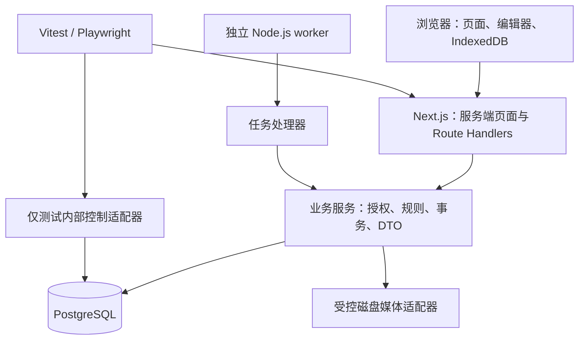
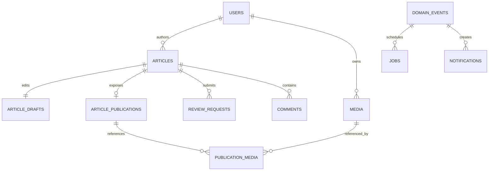
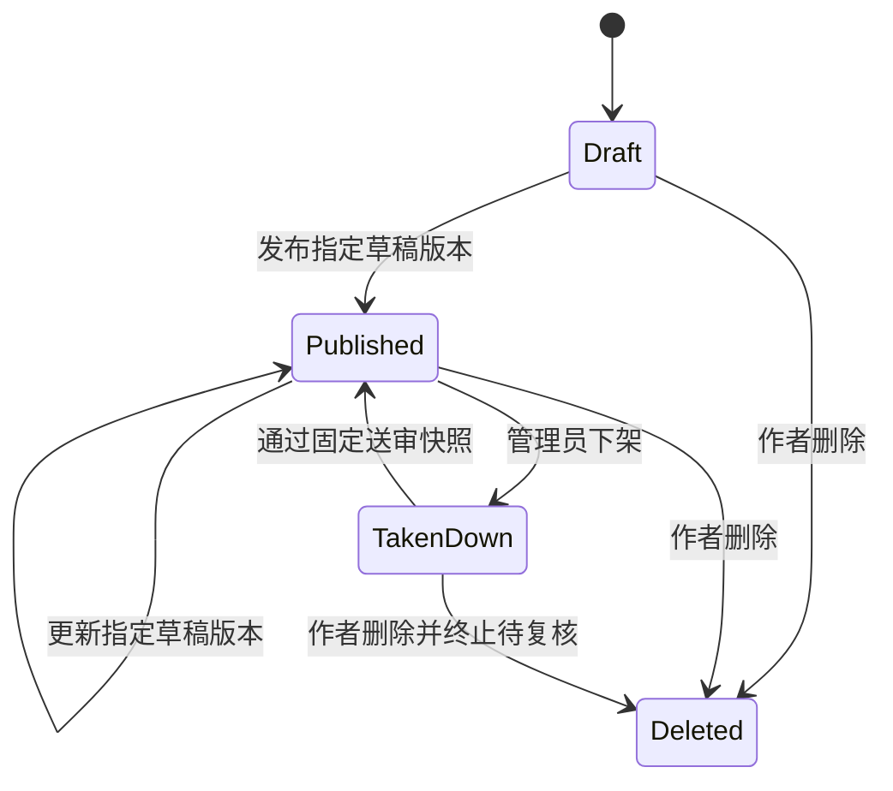

# Broker Blog 系统架构设计

日期：2026-10-15 · 版本：v1.6 · 状态：A1–A4 基础设施、账号认证、页面骨架、B1 受控媒体、B2 编辑器、B3 发布与内容管理及 B4 首页分发与个人资料已实现，业务模块继续按阶段落地。

依据：[产品设计 v0.3](MVP产品设计文档.md)、[技术方案 v1.2](MVP技术方案.md)、[HTML 原型](../prototype/index.html)及其 [说明](../prototype/README.md)、app.js、styles.css。配套执行任务见[开发规划](开发规划.md)，已实现部分见 [A2 基础设施说明](A2基础设施实施说明.md)、[A3 账号认证说明](A3账号与认证实施说明.md)、[A4 页面骨架说明](A4页面骨架与角色入口实施说明.md)、[B1 受控媒体说明](B1草稿与受控媒体实施说明.md)、[B2 编辑器说明](B2编辑器与本地恢复实施说明.md)、[B3 发布与内容管理说明](B3发布与内容管理实施说明.md)与 [B4 首页分发与资料说明](B4首页分发与资料实施说明.md)。本文细化既定技术路线，不替代产品权限矩阵和验收编号。原型以源码和交互定义核对；A3 新页面已执行桌面/手机浏览器视觉检查，A4 骨架、B2 编辑器与 B4 首页/标签/作者主页同样以双视口口径实现（B4 的浏览器验证待后续测试轮次执行）。

## 1. 设计结论与原型差异

采用单仓库、模块化单体：Next.js 承担页面和 HTTP 接口，独立 Node.js worker 消费 PostgreSQL 持久任务；Drizzle 管理数据库；图片在网站静态目录以外持久保存。Windows 原生开发，Linux Compose 完整验收与单机部署。无需 Redis、消息中间件或独立后端服务。

| 来源差异 | 本次实施口径 |
| --- | --- |
| 原型把通知及个人入口集中到头像菜单，侧栏仅发现与标签 | 沿用这一导航组织，菜单支持触屏和键盘；全部 P0 入口仍可达，管理员入口按真实角色展示 |
| 原型搜索有标题、正文、作者范围，缺少标签综合匹配 | 按产品基线实现标题、标签、正文跨字段综合搜索；作者筛选保留为候选扩展，不能默认为 P0；上线前替换原型范围控件 |
| 原型包含“已进入复核队列”通知 | 提交成功在内容管理反馈；P0 只发送产品明确的复核通过/驳回通知 |
| 原型精选、计数、人物、分页和最新排序均为演示 | 接入真实查询与关系计数；空库展示空态，精选为空回退最新；不能沿用演示成功提示 |
| 原型使用文章 ID 推导作者，头像菜单显示固定用户 | 使用独立用户 ID 和会话 DTO，游客显示登录入口，正常用户提供真实退出 |
| 原型编辑器是 textarea、简化预览和手动状态选择器 | 换成 CodeMirror 6、统一 Markdown 渲染和真实保存状态机；移除状态演示选择器 |
| 右栏展示固定作者推荐，卡片展示装饰缩略图 | 标签与写作入口保留；不新增推荐算法、封面上传功能；作者推荐区暂不列为必交付功能 |

绿色主题、浅灰底色、白色卡片、桌面侧栏、移动搜索入口作为界面参考。原型样式拆成设计变量和组件样式，不直接移植全局 DOM 字符串拼接与事件处理。

## 2. 运行结构与依赖方向



页面读取通过服务端查询服务；浏览器写入统一走 `/api/v1` Route Handlers，便于真实接口测试。路由只解析请求、校验会话/CSRF、调用用例和映射响应；事务由业务服务拥有。模块 repository 只在服务内部使用，组件不可直接查表。worker 不依赖 Next.js 请求上下文；共享纯规则、数据库和配置模块。

| 模块 | 拥有的数据与责任 | 对外服务示例 |
| --- | --- | --- |
| identity | 用户、会话、验证码、限流；实时账号状态 | authenticate、requireWritableActor、updateProfile |
| content | 文章、工作草稿、公开版本、标签关联 | saveDraft、publishVersion、deleteArticle |
| media | 文件生命周期、引用合法性、受控读取 | upload、validateReferences、authorizeRead |
| discovery | 公开文章查询、标签、精选展示（检索在 C1 落地） | listFeed、listTags、loadTag、loadAuthor |
| social | 点赞、收藏、关注、评论及计数 | setLike、setFollow、createComment |
| notifications | 通知、已读状态、深链接定位 | listMine、markRead、resolveTarget |
| moderation | 举报、复核、下架、封禁、标签治理、精选、审计 | submitReview、decideReview、resolveReport |
| jobs | 事务事件、领取、租约、重试、运行状态 | enqueueInTransaction、claim、complete |

治理模块通过 content 提供的事务内操作修改文章，不复制发布逻辑；content 不反向调用治理服务。跨模块用例显式传入同一个事务对象。读取投影与写入模型分离，但仍共用一个数据库，不建立异步搜索副本。

目录规划（A1/A2 已建立基础部分，其余随业务阶段创建）：

```text
src/
  app/                    # 页面、布局、api/v1、站点地图
  components/             # 导航、卡片、表单、Markdown 等共享 UI
  features/editor/        # CodeMirror、保存调度、本地恢复
  modules/<domain>/       # service、policy、repository、dto
  contracts/              # 请求/响应 schema、错误码；不含数据库凭证
  infrastructure/         # db、storage、clock、日志、密码与验证码适配器
  worker/                 # worker 入口、处理器注册
  config/                 # 环境校验与集中业务参数
drizzle/                  # 可审查迁移
scripts/                  # 跨平台启动、初始化、重置、验收、清理
tests/{rules,api,e2e,fixtures}/
deploy/                   # Dockerfile、Compose
docs/                     # 基线、设计、运行说明
prototype/                # 独立静态参考稿
```

## 3. 数据模型与约束

ID 由服务端生成，公开 API 将 ID 当作不透明字符串；时间存 UTC，界面按显示时区格式化。所有字符限制按 Unicode 码点计算。数据库迁移维护外键、CHECK、唯一约束和索引，不能只依赖表单校验。

| 表/实体 | 核心字段 | 数据库约束与索引 |
| --- | --- | --- |
| users | id、email_normalized、password_hash、role、status、nickname、bio、avatar_media_id | 邮箱唯一；角色/状态 CHECK；头像外键 |
| sessions | token_hash、user_id、expires_at、revoked_at、csrf_hash | token_hash 唯一；用户/有效期索引；不存原始 token |
| captcha_challenges | browser_binding_hash、purpose、answer_hmac、expires_at、attempts、consumed_at、invalidated_at | 用途/次数 CHECK；挑战行锁控制一次性消费 |
| rate_limit_buckets | action、subject_hash、window_start、count | 维度联合唯一，原子递增；定期清理过期窗口 |
| articles | id、author_id、status、state_version、first_published_at、updated_at、takedown_reason | 作者外键；状态 CHECK；公开列表 `(first_published_at,id)` 索引 |
| article_drafts | article_id、version、title、markdown、summary、saved_at | article_id 主键；条件更新 version |
| article_publications | article_id、source_draft_version、title、markdown、plain_text、summary、published_at | article_id 主键；仅保留当前发布内容，不承诺完整版本历史 |
| review_requests | id、article_id、source_draft_version、固定内容字段、status、submitted_by、decision_by、reason、version | 每篇文章仅一个 pending 的部分唯一索引；固定内容不可更新 |
| tags | id、slug、name、enabled | slug 唯一且不随改名变化；停用不物理删除 |
| draft_tags / publication_tags / review_tags | 对应内容 ID、tag_id | 联合主键与外键；公开查询只使用 publication_tags |
| media | id、owner_id、storage_key、mime、size、status、created_at | storage_key 唯一；状态 staging/ready/failed；大小 CHECK |
| draft_media / publication_media / review_media | 内容 ID、media_id | 联合主键、外键；头像引用由 users 外键表示；避免无约束多态引用 |
| likes / bookmarks | user_id、article_id、created_at | 联合主键；收藏本人列表索引 |
| follows | follower_id、followee_id、created_at | 联合主键；CHECK 禁止自关注；双向列表索引 |
| comments | id、article_id、author_id、root_id、reply_to_id、body、status、created_at | 复合外键保障目标同文章；根层级规则在锁内校验；根与回复分页索引 |
| reports | reporter_id、article_id 或 comment_id、reason、status、public_result、internal_note、version | CHECK 仅一种目标；分别对 pending 文章/评论举报建部分唯一索引 |
| featured_articles | article_id、position | article_id 唯一；按 position、article_id 稳定排序 |
| audit_logs | actor_id、target_type/id、action、reason、request_id、created_at | 仅追加；无普通业务更新/删除入口；应用数据库权限限制覆盖 |
| idempotency_keys | actor_id、operation、key、request_hash、resource_id、result、created_at | actor/operation/key 联合唯一；不存完整私人正文或凭证 |
| domain_events / jobs | event_id、type、safe_payload；job 状态、available_at、attempts、lease_until、lease_token | 每事件/处理器唯一任务；待处理领取索引 |
| notifications | recipient_id、event_id、type、target_ids、safe_message、read_at | recipient/event 唯一；本人未读/列表索引 |

草稿标签和图片引用允许保存不满足发布条件的编辑中状态，但不能引用他人私有媒体；发布和送审再强校验 1–3 个有效标签、所有图片 ready、正文/标题非空。复核快照连同标签 ID 和媒体 ID 固定，显示名称按当前标签资料读取。



图仅展示主关系，详细表以表格及后续迁移为准。已删除文章保留内部记录，但所有游客查询排除；收藏返回失效占位，禁止序列化旧摘要。公开 DTO 不包含邮箱、草稿、举报内部备注或磁盘键。

## 4. 文章状态、版本与事务

### 4.1 三份内容与两类版本

- 工作草稿可以持续编辑，`draft.version` 每次成功保存递增。
- 公开内容仅在发布或复核通过时替换，记录来源草稿版本；公开链接和首次发布时间不变。
- 送审快照在提交时固定，不跟随后续草稿更新。通过只复制快照到公开内容。
- `article.state_version` 在发布、下架、删除、提交/撤销/结案复核等状态相关操作后递增。请求带预期状态版本；复核另有记录版本防止重复结案。
- “有未发布修改”按当前草稿版本与公开来源版本比较。通过 v5 时若工作草稿已经 v6，则保留 v6。



复核独立状态为 pending → approved/rejected/withdrawn/terminated；终态不可重判。下架后无直接发布入口，作者不能将已发布内容退回草稿。

### 4.2 统一写入顺序

1. 校验请求格式、会话、CSRF；事务中再次确认实时账号状态和资源权限。
2. 创建/锁定幂等记录；同键不同请求摘要返回 409，同键已成功返回原结果标识。
3. 获取必要行锁并比较预期版本；同一资源的所有写路径遵守同一顺序。
4. 校验状态、标签、媒体等前置条件；写业务数据、关联、审计及必要事件/任务。
5. 在同一事务中保存幂等结果并提交；返回 DTO。事务失败不留下“已完成”幂等记录。

拟定锁顺序：幂等键 → 涉及的用户（ID 排序）→ 文章（ID 排序）→ 草稿/复核/评论/举报 → 标签（ID 排序）→ 媒体（ID 排序）→ 关系、审计、事件。封禁事务也锁目标用户，标签停用也锁相同标签行；这样通过复核与封禁/停用不会各自基于过期状态成功。所有分支须在实现前核对锁顺序，遇数据库死锁仅有限次内部重试，不把版本冲突自动改成新版本提交。

删除与复核通过都先锁文章，再检查状态版本。删除成功后旧通过请求必失败；若通过先成功，携带旧状态版本的删除返回冲突，用户刷新确认后再删除。草稿保存锁文章后做 `WHERE version = baseVersion` 条件更新，发布同样锁文章和草稿，确保不会发布未确认版本。

治理成功时状态、举报处理结果（若来自举报）、审计、通知事件原子提交。对象已失效时仍可结案举报并审计，但不再次处罚。下架同时撤销精选记录；复核恢复不重新加入精选。封禁不隐式下架历史文章。

幂等记录在本期验证环境内保留，不随短会话到期删除；清理只随本轮测试资源清理。返回旧成功结果仍须检查当前身份和读取权限，不能通过幂等回放泄露现已不可读内容；结果只保存资源 ID、版本等最少字段。

## 5. 接口契约

以下为拟定接口，不代表仓库已有实现。成功响应 `{data, requestId}`；列表增加 `nextCursor`，需要结果数的搜索返回当前查询的 count。错误统一 `{error:{code,message,fieldErrors?},requestId}`。400 参数错误，401 会话失效，403 禁止操作，404 不存在或无读取权限，409 版本/状态/幂等冲突，413 文件超限，429 限流，503 暂时不可用。内部错误不向客户端泄露数据库或文件路径。

| 接口组（统一 `/api/v1` 前缀） | 权限与请求重点 |
| --- | --- |
| `POST /auth/captcha`、`GET /auth/captcha/:id/image` | 匿名浏览器绑定；创建/刷新限流；仅返回挑战 ID、有效期与图片地址 |
| `POST /auth/register`、`POST /auth/login`、`POST /auth/logout`、`GET /session` | 邮箱+密码+验证码真实校验；登录不创建账号；退出撤销会话 |
| `GET /users/:id`、`PATCH /me/profile` | 公开资料 DTO；修改仅本人且正常账号 |
| `POST /articles`、`GET/PATCH /articles/:id/draft` | 新建幂等键；保存 baseDraftVersion；草稿仅读写本人，封禁仅只读 |
| `POST /articles/:id/publish`、`DELETE /articles/:id` | stateVersion、draftVersion（发布）、幂等键；删除二次确认在 UI 执行 |
| `GET /articles/:id`、`GET /articles`、`GET /search` | 仅公开内容；列表支持最新/精选、标签/作者；搜索 q、sort、cursor |
| `GET /tags`、`GET /tags/:slug`、`GET /me/articles` | 标签发现与本人分类列表；停用标签的既有公开文章仍可访问 |
| `POST /media`、`GET /media/:id` | 上传认证/CSRF/幂等键；读取按当前有效引用授权 |
| `PUT /articles/:id/like`、`PUT /articles/:id/bookmark`、`PUT /users/:id/follow` | `{active:true/false}` 目标状态；不使用 toggle；重复设置不产生新事件 |
| `GET /me/bookmarks`、`GET /users/:id/followers`、`GET /users/:id/following` | 收藏私有；列表分页；失效收藏仍可取消 |
| `GET/POST /articles/:id/comments`、`GET /comments/:id/replies`、`DELETE /comments/:id` | 创建带 replyToId 和幂等键；同文章、两层、目标可见校验 |
| `GET /articles/:id/comments/:commentId/context` | 定位通知对应根评论与回复分页锚点；不可用返回安全状态 |
| `GET /notifications`、`PUT /notifications/:id/read`、`POST /notifications/read-all` | 本人；封禁用户仅允许读取，不允许已读写入 |
| `POST /reports`、`GET /me/reports` | 举报仅正常用户；本人结果投影，不泄露内部备注 |
| `POST /articles/:id/reviews`、`GET /articles/:id/reviews`、`POST /reviews/:id/withdraw` | 所有者；提交绑定版本；撤销需 pending |
| `/admin/articles`、`/admin/users`、`/admin/reports`、`/admin/reviews` | 管理查询；下架、封禁/解封、结案、通过/驳回采用独立 POST 动作，带原因、版本、幂等键 |
| `/admin/tags`、`/admin/featured`、`GET /admin/audits` | 标签新增/改名/停用、精选设置/排序；全部变更审计，日志只读 |

所有业务写接口默认要求正常账号；注册、登录和退出按产品例外处理。管理员也受账号状态约束。认证前写接口校验本站 Origin 与匿名浏览器绑定，认证后再校验会话 CSRF token。前端隐藏按钮不是权限控制。

## 6. 编辑器与页面落地

页面路径沿用产品 4.1 节，补充 `/tags` 为标签总览；原型 `#profile` 映射当前用户主页，文章和用户不共用 ID。管理后台拆成 `/admin/{articles,reports,reviews,users,tags,featured,audits}`，共用布局但分别授权。

服务端输出文章标题、摘要、正文与 metadata；客户端增强复制、目录、互动和评论。草稿、管理页、媒体及所有内容读取禁用共享响应缓存；公开内容按当前状态读取，不能依赖延迟失效。浏览器已加载页面可能保留既有文字，但新的读取请求必须执行当前授权。

编辑状态分为 `dirty/saving/synced/failed/conflict`，另设独立 `localBackupStatus`，避免将“本地已备份”显示为服务器已保存。每次保存捕获输入序号：响应返回时若用户又输入，仍为 dirty。一个编辑窗口只保留一个在途保存请求，后续合并最新输入；失败重试使用相同操作键。

IndexedDB 主键为 `(userId, articleId或tempDraftId, editorSessionId)`；刷新通过 sessionStorage 保留窗口 ID，新窗口检测重复 ID 后分配新 ID（例如 BroadcastChannel 握手），不覆盖旧窗口副本。临时草稿创建成功后迁移本窗口键，保留版本与文本。备份最长 1 秒；保存停止输入 3 秒、持续输入最长 30 秒；冲突立即停自动提交，恢复必须由用户选择。主动退出清理该账号副本，清理失败明确提示并隔离访问；会话过期则保留。

发布先等待当前输入成功保存，再显示/确认对应版本；请求不得自动切换到冲突后的服务器版本。媒体统一使用受控媒体 URL，拒绝把 blob/data URL 或任意外部图片当发布引用。预览与正文共用 Markdown 规则，禁用原始 HTML；链接只允许批准协议，纯文本评论和摘要按文本输出。

## 7. 媒体持久化与撤权

上传流程：登记 staging 和上传幂等键 → 写受控临时文件 → 验证真实格式、体积和可解码性 → 原子移动到服务端生成的最终键 → 更新 ready → 返回媒体 ID。5 MB 的字节边界在 B1 固定并加入边界测试；不接受 SVG、附件及客户端文件路径。

文件和数据库不是一个事务。中断后依据 staging 记录、实际文件和幂等键恢复或标记失败，不能返回假成功；响应丢失后相同键复用 ready 结果。定期清理只处理超过宽限期、无引用、无有效上传租约的文件，锁媒体行并二次检查；引用创建也锁同一媒体行。孤立文件扫描必须确认不在活动上传中，不按单纯创建时间删除。

读取允许：所有者；当前 published 内容的 publication_media；已保存公开头像；有治理权限且引用于可审查下架内容/固定送审版本的管理员。草稿引用不能授予管理员额外权限。下架和删除使对应公开引用立即失效，但同一媒体仍有其他有效公开引用时保持公开。路径规范化与根目录包含性检查同时阻止 `..`、绝对路径和符号链接/重解析点越界。

应用设置真实 Content-Type、nosniff、禁止缓存的响应策略；文件根目录不映射到 public 或静态服务器，内部路径不进入 DTO。清理与读取错误返回可追踪 requestId。

## 8. 搜索、关系与通知

### 8.1 搜索与分页

拟定评分：查询 trim、按空白拆词、英文小写、重复词去重。每词必须命中 title、当前标签名、正文纯文本之一。记仅按每词最高命中字段计算的计数向量 `(标题词数, 标签词数, 正文词数)`，按向量字典序倒序，再按首次发布时间和 ID 倒序。该方案确保标题优先于标签、标签优先于正文；在 C1 固定跨字段及多词样例后实施。正文 plain_text 从公开 Markdown 提取，排除代码语法标记但保留可见代码文本；错误码不被切碎。标签改名直接参与实时查询。

SQL 参数化并转义 `%`、`_` 和 escape 字符。首版允许同库扫描，不声称普通 B-tree 能加速前缀为 `%` 的任意包含匹配；本期不加外部索引服务。最新游标用 `(firstPublishedAt,id)`；相关性游标加评分向量；精选游标用 `(position,id)`。游标包含排序及查询摘要并做完整性校验，变更搜索条件时重置。静态数据无重复遗漏，新增不使用 offset 导致重复；不保证并发编辑时的历史快照。

### 8.2 关系、评论和计数

关系唯一约束兜底。新增互动需文章 published；取消已失效关系允许正常用户执行。计数直接聚合事实关系，批量查询避免每卡片单独读取，不先引入异步计数缓存。关注只有 false→true 的实际变化创建新事件，取消后再关注可产生新通知。

评论事务锁文章和回复目标；删除/隐藏顶层后返回占位和合法回复，不返回原正文。回复必须指向可见目标，rootId 由服务端计算。顶层倒序、回复正序，时间与 ID 联合分页；深链接接口先核实文章可读，再返回目标和所属根的定位信息，支持跨页加载。

### 8.3 事务事件与 worker

业务事务写 domain_event 和 job；只在产品明确事件发生时排任务，发布本身不额外通知。worker 短事务领取到期任务，使用行锁和 `SKIP LOCKED`，写 lease_token、lease_until 后提交；执行中不长时间持有领取事务。此用法面向队列，不用于普通内容查询。[PostgreSQL SELECT 文档](https://www.postgresql.org/docs/current/sql-select.htm)

拟定参数：每批 20 条、租约 60 秒、需要时每 20 秒续租；失败延迟 5 秒、30 秒、2 分钟、10 分钟、30 分钟，之后进入 failed，受限脚本可重试。参数集中配置，测试可控时钟。过期租约可重新领取；完成、失败更新均比较 lease_token，旧 worker 不能覆盖新领取者。处理器按至少一次执行设计：写通知时依靠 `(event_id,recipient_id)` 唯一约束，写成功但任务未确认时重跑也不重复。

接收者由事件发生时的事实确定，载荷仅保存 ID 和安全说明：顶层评论→文章作者，回复→被回复者，关注→被关注者，治理/复核→被处理作者；排除自己，不给文章作者额外发送回复通知，不发送点赞或举报结果通知。

全部已读用单条 SQL 更新该语句快照中本人已有的未读通知；之后提交的新通知保持未读。通知展示不嵌入私有/违规正文，目标不可用显示安全说明。worker 提供心跳、任务状态和最后错误分类，不记录敏感载荷。

## 9. 认证、安全和运行配置

A3 已固定原生 scrypt 参数 N=131072/r=8/p=1、密码 12–128 字符单位、7 天会话及持久限流阈值，完整参数与实现见 [A3 账号与认证说明](A3账号与认证实施说明.md)。随机会话 token 仅进 HttpOnly Cookie，库中存 HMAC；验证码低熵答案使用服务端密钥 HMAC 校验，绑定匿名浏览器及用途，10 分钟有效、最多 5 次尝试。失败计数独立成功提交，不随业务校验失败回滚；成功消费后即使密码错误也要求新挑战，页面同步刷新。并发校验锁同一挑战行，只有一次可消费；部分唯一索引保护同绑定、同用途最多一个活动挑战。

权限检查接近数据读取与修改处，服务端组件传给客户端的也只能是最少 DTO；API 和管理接口各自检查身份，不能只依赖布局或跳转拦截。[Next.js 认证指南](https://nextjs.org/docs/app/guides/authentication)

| 配置组 | 拟定配置责任 |
| --- | --- |
| 环境 | APP_ENV、APP_ORIGIN、DATABASE_URL、MEDIA_ROOT、LOG_LEVEL |
| 安全 | SESSION/CSRF/CAPTCHA 密钥、密码参数、各用途限流；密钥不得用 NEXT_PUBLIC 前缀 |
| 任务 | 领取批量、轮询、租约、重试上限、worker 实例 ID |
| 测试 | TEST_RUN_ID、隔离数据库、媒体根、受控时钟、故障适配器；仅 test 模式启用 |

测试验证码答案只通过受限内部通道交给执行器，不进入普通 API、图片替代文字、日志或报告。非测试配置发现测试适配器开启时直接启动失败。截图/轨迹对密码和验证码输入遮罩，私人正文故障用例不采集完整页面载荷。

Linux Compose 包含 web、worker、postgres、一次性 migrate/seed 和 test runner；web/worker 使用同一构建版本，媒体挂载持久卷，数据库独立持久卷。迁移先成功再启动应用，不让每个进程竞相迁移。健康检查区分进程存活、数据库就绪和 worker 心跳。迁移/初始化不能清空已有业务数据。

## 10. 架构验收与待落实项

高风险优先验证：三份内容隔离、发布与删除竞争、封禁/标签停用和复核竞争、文件成功但数据库失败、通知插入后 worker 中断、多窗口恢复、无脚本正文及媒体撤权。详细任务和全部产品编号见开发规划。

阶段 A 固定版本与认证参数；B 固定渲染扩展、上传字节边界、编辑窗口识别；C 固定搜索样例；所有阶段提交迁移与测试证据。上述实现细节可经测试调整，但改变产品行为或扩大 P0 必须同步修订产品与技术基线。对外上线、备份恢复指标、生产容量及邮箱归属验证不属于本次完成标准。
